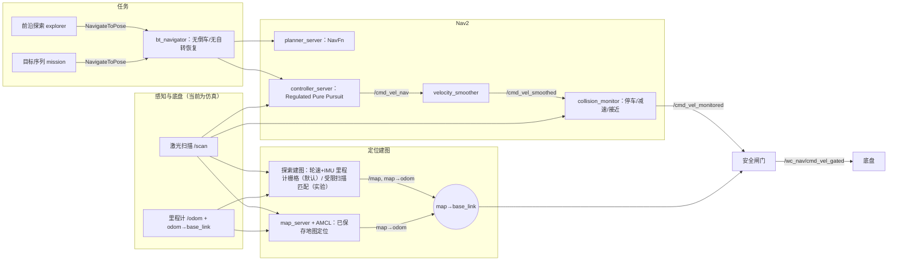

# 自主导航总体框架

本文说明自主建图、路径规划和自动驾驶在本项目中的整体结构，以及仿真组件与实车组件的对应关系。当前框架只在仿真中闭环运行；接入实车所需的适配器和验收条件单独列出，未实现前不得连接车辆。

## 分层与数据流

- 局部安全不依赖全局定位：局部代价地图在 `odom` 坐标，碰撞监控直接使用当前扫描，所以全局定位出错时仍能避免撞到看得见的障碍。
- 全局定位只负责“去哪里”：规划在 `map` 坐标；闸门检查 `map→base_link` 的新鲜度、AMCL 协方差（必要条件）以及 `map→odom` 修正速度。修正在 2 s 内超过 0.25 m 或 5° 时停车，稳定 3 s 后恢复。
- 速度命令只有一条路径到底盘，任何进程都不发布 `/cmd_vel`。闸门在急停锁存、操作员使能心跳超时、定位不可信、命令过期时输出显式零速，并限速、禁止倒车。

## 关键约束

| 约束 | 原因 | 框架中的落实 |
|---|---|---|
| 不倒车 | 车体后方没有测距传感器 | RPP `allow_reversing=false`，平滑器最小线速度 0，闸门拦截负线速度，行为树不含 BackUp。 |
| 不自行原地自转恢复 | 非圆形车体自转会扫过看不见的后方 | 恢复只清理代价地图并等待；探索开始时的 360° 环视是显式任务动作，实车需另行确认。 |
| 未知区不当作空地 | 项目既有原则 | 导航模式规划禁止穿越未知并在未知周围膨胀；探索模式规划允许以接近致命的代价穿越未知，但目标点只选已知空闲且留足间隙的位置。 |
| 包络是假设值 | 含脚踏的实测外形尚未量取 | 默认圆形半径 0.55 m。也可给凸多边形外形（`NavProfile.footprint`，车轴为原点）：全局代价地图用外形加余量，规划按其内切半径通过；局部代价地图（控制器沿弧线和原地转向的碰撞检查）、碰撞监控停车区（外扩 2 cm）和接近模型用完整外形。仿真底盘碰撞仍按圆，多边形目前只用于影子运行。报告都标注外形来源。 |
| 余量只在规划中硬性保留 | 余量也计入控制器碰撞检查时，1.8 m 门口每侧只剩 0.25 m，正常跟踪偏差就会让控制器判定“前方碰撞”而停死，此时真实车体离墙仍有 0.8 m 以上 | 全局代价地图致命半径 = 车体 0.55 m + 余量 0.10 m，规划路径都保留余量；局部代价地图（RPP 碰撞检查）、碰撞监控和仿真碰撞都用车体半径。 |
| 建图位姿以轮速+IMU 里程计为准 | 与 ADR 0001 一致；在已录走廊上，纯里程计建出的地图比加扫描匹配的更自洽（见下节）；前向窄视场下 slam_toolbox 会把航向拖偏 | 默认 `odom_grid`：按每帧里程计位姿写栅格，`map` 与 `odom` 重合。`odom_icp`（里程计先验 + 法向一致、只沿受约束方向、有上限的点到线修正）保留为实验选项。都没有回环。 |
| 不做自动回环 | 窄视场加相似房间时，仿真中 slam_toolbox 的错误回环一次把地图修正移动约 2 m | 三种建图方式都不做回环；闸门另外检测 `map→odom` 修正突变（2 s 内超过 0.25 m 或 5° 即停车）。 |
| 碰撞监控停车区是贴身圆 | 前方停车框会连原地转向一起禁止；仿真中轮椅因此在 1.8 m 门口停了 170 s，而在假设圆内原地转向本来没有碰撞 | 停车区为车体半径外 2 cm 的圆（只在即将接触时停车）；前进方向的减速由“接近”模型按预测的接触时间处理，另有减速框。 |
| 前向窄视场 | XT-M60 水平约 ±57.5°（由 RoomA1 原生帧统计） | 仿真按此建模；探索开始先原地环视一周。 |

## 建图方式对比（仿真）

同一 `two_rooms` 世界、同一里程计误差模型（`wheel_imu`，种子 1），各运行 600–700 仿真秒；误差按仿真真值计算。

| 建图方式 | 运行 | 定位位置误差 均值 / 最大 | 航向误差最大 | 同次纯里程计误差最大 | 空闲区覆盖 | 误判空地 | 前沿目标到达 |
|---|---|---|---|---|---|---|---|
| slam_toolbox（加强先验、无回环） | 20261105T024902Z | 0.28 / 0.74 m | 12.4° | 0.33 m / 3.5° | 86% | 2.08 m² | 8/10 |
| `odom_grid` 纯里程计 | 20261105T033601Z | 0.27 / 0.92 m | 12.5° | 同左 | 94% | 1.44 m² | 16/17 |
| `odom_icp` 初版（无法向检查与方向投影） | 20261105T052035Z | 0.74 / 1.24 m | 7.0° | 0.86 m / 15.5° | 86% | 2.77 m² | 15/16（到时限） |
| `odom_icp` 当前版 | 20261105T082134Z | 0.04 / 0.09 m | 3.4°（p95 1.0°） | 1.06 m / 12.3° | 97% | 0.00 m² | 11/11 |

slam_toolbox 的航向误差比它自己的里程计输入还大，偏差集中在原地转向时：新进入视场的点落在未建图区域，向后转的候选位姿能把它们放回旧墙上而得分更高。初版点到线匹配航向基本正确，但在稀疏地图的墙角附近转向时，平移两次滑移约 0.5 m；加入法向一致性检查和“只沿受约束方向修正”后消失。这些数字只说明仿真里的相对表现；真实雷达的点云畸变、时间偏移和动态障碍都没有建模。

### 已录走廊上的离线重放

`bash scripts/navigation_replay_mapping` 把同一套建图代码用在 2026-10-11 走廊录包的精确单左前端（684 帧，约 180 s，其中前约 60 s 停在原地）：每帧取已准备的左雷达点、投影成与 AMCL 回放相同的 161 个 0.75° 扇区，按冻结的轮速+IMU 先验位姿建图，缺测扇区不清空。每 5 帧留出 1 帧不参与建图和匹配，结束后用各方法给它预测的位姿，量留出帧端点到最终地图的距离。没有外部真值，这只是同一录包内的自洽性。

| 建图方式 | 留出端点到地图 中位 / p90 | 10 cm 以内 | 结束时累计修正 |
|---|---|---|---|
| `odom_grid` 纯里程计 | 0.030 / 0.22 m | 73% | 无 |
| `odom_icp` | 0.041 / 0.63 m | 63% | 0.95 m、−4.4° |

纯里程计地图里两段走廊互相平行、墙线细；加扫描匹配后下段走廊整体转了约 4°，留出帧与地图的不一致明显变大。仿真里扫描匹配大幅降低了误差，真实数据上却相反，说明真实点云的系统误差（不同视角下墙面位置不一致）在逐帧匹配中会累积，而这台车的轮速+IMU 航向在 2 分钟量级上相当稳定。因此默认用纯里程计建图，与 ADR 0001 一致；扫描匹配要在更长的真实录包上证明有改善后再考虑启用。结果在 `reports/navigation_replay_mapping/20261105T084921Z_ba19bb37`。

这张纯里程计地图里有 231 个被已知格包围的小未知块（≤20 格），27% 的车轴路径点离未知格不到 0.65 m。逐格检查路径附近的 41 个未知格，全部既有回波也有穿透（中位 5 次回波、25 次穿透），说明它们来自有人走过或零星回波，而不是没看到。规划把未知格当障碍并按包络膨胀，一个这样的格就能封住 2.6 m 走廊。因此建图重放另存 `map_nav.yaml`：看过至少 5 次、回波不超过 25% 的格记为空闲，观测不足的格仍为未知。同一录包上小未知块降到 140 个，路径附近未知的比例降到 6%，占据格与留出帧指标不变（`reports/navigation_replay_mapping/20261106T081526Z_4493610a`）。改用 0.25° 扇区没有减少小未知块（271 个），印证它们不是射线间隙。

### 已录走廊上的 Nav2 影子运行

`bash scripts/navigation_nav2_shadow` 让同一录包的运动带动 `base_link`、录到的扫描进入代价地图和碰撞监控，Nav2 全链路照常计算并逐级记录指令，但没有任何进程接收闸门输出。`navigate` 模式朝录包中 15 s 后的位姿规划；`follow` 模式把司机接下来 15 s 的路线直接交给控制器，只检验控制器、碰撞监控和闸门。地图为上面的 `map_nav.yaml`，窗口 57–180 s，速度上限 0.30 m/s（司机中位 0.52 m/s）。

| 运行 | 假设包络 | 规划成功 | 司机前进时 Nav2 也前进 | 没有指令 | 原地转向 | 控制器零输出 | 转向方向一致 |
|---|---|---|---|---|---|---|---|
| `navigate` | 0.55 m + 0.10 m | 65/122（53%） | 19% | 35% | 38% | 5% | 96% |
| `follow` | 0.55 m + 0.10 m | 不经规划 | 71% | 3% | 17% | 9% | 99.5% |
| `navigate` 敏感性 | 0.45 m + 0.10 m | 87/122（71%） | 30% | 17% | 46% | 4% | 95% |
| `follow` 敏感性 | 0.45 m + 0.10 m | 不经规划 | 77% | 2% | 17% | 3% | 99.5% |

假设包络下的 57 次规划失败：未知格膨胀后截断路线 20 次（16 次卡在下段走廊 x≈14 m 的一个格，4 次卡在上段 x≈3 m 附近的几个格，都有冲突证据，约 30% 回波）；实时扫描里的临时物体截断路线 20 次、压住起点 1 次（71–80 s、128–141 s、150–152 s，很可能是走廊里的人，车在 130–135 s 停住等待）；起点离地图障碍不足 0.65 m 12 次（出发停车位左侧 0.55 m 有障碍，x≈3.3 m 处司机离障碍只有 0.40 m）；4 次用录下的代价地图也解释不了。半径减 0.10 m 后，地图造成的失败从 32 次降到 1 次，其余 29 次来自实时扫描，5 次未能解释。

`follow` 模式里控制器转向几乎总与司机同向，急弯处（90° 拐角、x≈19 m 掉头、左下房间）改为原地转向，而司机是边走边转。控制器自身的前方碰撞检查触发 72 次，集中在 x≈3.3 m 窄处（去程与返程）、136–138 s 车前有物体、左下房间转身处以及回停车位的最后几米；碰撞监控停车 2 次、减速 19 次（行驶时间的 4%），扫描落进停车圈的 3 帧（136.1、174.3、174.5 s）正是近回波核查列出的帧。`navigate` 模式里的原地转向只有约五分之一来自离规划路线超过 0.3 m：15 s 前方目标跳过了司机的掉头和进房间，规划路线在那里直接回头，开环下轮椅又不会跟着回来。

结论：整套规划、控制和停车链路已能在真实扫描上运行，方向判断与司机基本一致；在这栋楼里决定“走不走得了”的主要是假设的圆形包络，其次是走廊里的临时物体和建图时留下的冲突格。半径的敏感性只说明实测包络很值得做，不是缩小包络的理由。结果在 `reports/navigation_nav2_shadow/` 下的 `20261106T091827Z_shadow_navigate_619524dd`、`20261106T091831Z_shadow_follow_3e511476`，敏感性为 `20261106T092605Z_shadow_navigate_55224c8d`、`20261106T092610Z_shadow_follow_6583d9d3`。

### 更长的办公室录包：RoomA1 与 RoomAB（实验外参）

2026-10-09 的两份办公室录包录制时没有冻结左雷达外参。经用户同意（2026-11-06），用与走廊前端相同的 2026-10-26 现场外参文件 `config/local/project/hardware_setup.json`（SHA256 12ea737c…，状态 USER_MEASURED_EXPERIMENT，轮半径 0.172 m）作显式覆盖生成单左前端，目录名带 `fieldext20261026_EXPERIMENTAL`。10-09 到 10-26 之间雷达是否重装没有记录；纯里程计地图墙线清楚、多次经过的过道互相重合，只是外参大体可用的旁证，不是验证。

| 录包 | 帧 / 时长 / 路程 | 纯里程计留出 中位 / p90 | 扫描匹配 | `map_nav` 小未知块 |
|---|---|---|---|---|
| 走廊 10-11 | 684 / 180 s / 56 m | 0.030 / 0.22 m | 0.041 / 0.63 m，结束修正 0.95 m | 140 |
| RoomA1 | 1709 / 443 s / 152 m | 0.033 / 0.38 m | 0.043 / 0.45 m，结束修正 1.1 m、8° | 471 |
| RoomAB | 1994 / 515 s / 170 m | 0.043 / 0.46 m | 0.031 / 0.55 m，结束修正 6.4 m、6° | 563 |

RoomAB 上扫描匹配的留出中位更低，地图却明显转歪：地图和修正后的位姿一起歪时，同录包自洽性也会好看。纯里程计仍是默认，地图是否成形要和指标一起看。

| 录包 | 路径离地图障碍不足 0.65 m | `navigate` 规划成功 | 司机前进时 Nav2 也前进（navigate / follow） | follow 控制器前方碰撞 | 转向方向一致（follow） |
|---|---|---|---|---|---|
| 走廊 | 11% | 65/122（53%） | 19% / 71% | 72 次 | 99.5% |
| RoomA1 | 60% | 20/377（5%） | 4% / 38% | 739 次 | 99.8% |
| RoomAB | 53% | 74/404（18%） | 10% / 60% | 440 次 | 100% |

办公室里过道夹在课桌群之间，司机沿路离最近地图障碍的中位距离只有 0.58 m（RoomA1）和 0.63 m（RoomAB），而 0.55 m 圆加 0.10 m 余量要求 0.65 m。规划失败大多是起点或路线贴着地图障碍（RoomA1 336/357 次，RoomAB 280/330 次），控制器沿司机路线也反复判定前方碰撞。司机两边都过得去，假设的圆过不去：轮距 0.61 m、胎宽 90 mm 的车体侧向半宽在 0.35 m 量级，远小于 0.55 m，圆形只适合描述原地转向时的最大外扫。路径最近处为 0 m、10% 的路径离障碍不到 0.21 m（RoomA1）或 0.40 m（RoomAB），说明建图时被移动过的椅子或经过的人也留在了地图里。

所以在办公室里，真正卡住自主导航的不是规划或控制算法，而是车体形状的表达和建图时的临时物体。

为此框架加了多边形外形（见“关键约束”），并用一个示例外形重跑办公室影子运行：车轴后 0.35 m、前 0.70 m、左右各 0.35 m 的矩形（1.05 m × 0.70 m，内切半径 0.35 m，外接半径 0.78 m）。它不是实测值，只用来说明外形的影响。

| 录包 | 车体 | 规划成功 | 司机前进时 Nav2 也前进（navigate / follow） | follow 控制器前方碰撞 | follow 碰撞监控停车 |
|---|---|---|---|---|---|
| RoomA1 | 圆 0.55 m | 20/377（5%） | 4% / 38% | 739 次 | 12 次 |
| RoomA1 | 示例外形 | 84/382（22%） | 10% / 50% | 633 次 | 57 次 |
| RoomAB | 圆 0.55 m | 74/404（18%） | 10% / 60% | 440 次 | 3 次 |
| RoomAB | 示例外形 | 236/403（59%） | 21% / 73% | 237 次 | 5 次 |

窄一些的侧向宽度让规划成功率提高到原来的三到四倍；RoomAB 剩下的规划失败多数来自实时扫描里的临时物体（101/167 次）。RoomA1 里示例外形的前端伸到 0.70 m，碰撞监控停车反而更多，控制器在过道里也拒绝了大量转向，因为原地转向时前角扫到 0.78 m，比 0.55 m 的圆还大。实际前端（脚踏和脚）伸多远，和车宽一样决定能不能走，必须实测。地图里离路径不到 0.21 m 的障碍格（RoomA1 的 10% 路径）说明还需要一次无人、椅子归位的建图录包。示例外形运行在 `reports/navigation_nav2_shadow/20261107T041734Z_*`（RoomA1）与 `20261107T042522Z_*`（RoomAB）。结果在 `reports/navigation_replay_mapping/20261107T002634Z_50d41bb4`（RoomA1）、`20261107T003902Z_ffba9d85`（RoomAB），影子运行为 `reports/navigation_nav2_shadow/20261107T002705Z_shadow_{navigate_18c9b4e3,follow_ad3cd90d}` 与 `20261107T003939Z_shadow_{navigate_c4070d03,follow_76c41c40}`。

## 仿真与实车的对应

| 组件 | 仿真中 | 实车需要的适配与证据 |
|---|---|---|
| 激光 | 真值栅格光线投射，±57.5°、0.3–8 m、1 cm 噪声 | 由左雷达点云投影 `LaserScan`，使用当前现场外参；保留近量程盲区与 -inf/+inf 语义。 |
| 里程计 | 加速度受限的差速模型；默认误差为轮速距离 2% 比例误差加陀螺航向偏置 0.0004 rad/s | 轮速 + IMU 融合（已有估计器，见 ADR 0001），航向零偏与时间偏移需核验。 |
| 初始位姿 | 监督进程发送带 0.25 m / 0.15 rad 标准差的近似位姿 | 操作员在界面上给出起点，或在已知停靠点启动；不能用零协方差假定位姿准确。 |
| 底盘 | 只接收闸门输出 | 经现有轮控所有者的已审定通道下发；急停、失联停止和制动距离实测通过前保持断开。 |
| 操作员使能 | 监督进程按仿真时间发送心跳 | 物理按住式使能或遥控器死人开关；松开即停。 |
| 急停 | `/wc_nav/estop` 锁存 | 物理急停为主，软件锁存只是附加层。 |

## 验证阶梯

1. 纯逻辑测试：闸门、前沿选择、光线投射、底盘模型、参数与行为树约束（`tests/navigation/test_autonomy_*.py`）。
2. 仿真闭环：合成楼层与已录走廊地图上的探索建图、保存地图后的 AMCL 目标序列、地图外障碍物；结果按任务归档。
3. 录包影子运行：冻结录包的扫描和运动驱动 Nav2 全链路，指令只记录（`navigation_nav2_shadow`，已在走廊录包上完成）。
4. 实车影子模式：真实传感器和定位运行整套框架，闸门输出不接底盘，人工推行时比较“框架会怎么做”。
5. 监督下低速闭环：在急停、制动、包络和定位条件满足后，在封闭区域按批准的速度和路线进行。

每一级只证明本级内容，仿真通过不代表实车可以运行。操作命令见[自主导航仿真](../operations/navigation_autonomy.md)；离线工具与既有证据见[离线导航开发](../operations/navigation_offline.md)。返回[系统设计](README.md)。
