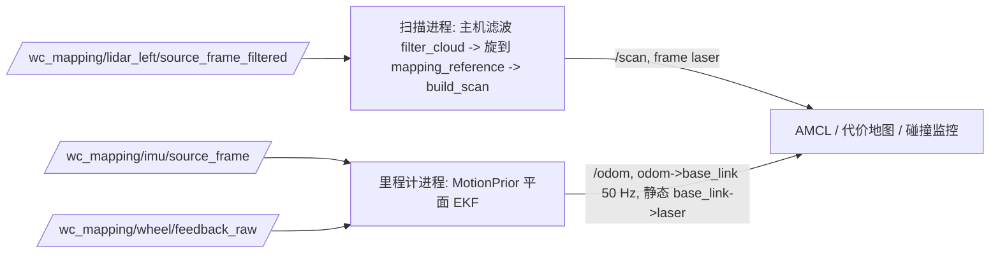

# 已存地图定位与实车影子链路

验证阶梯第 4 级（实车影子模式）是：真实传感器加已存地图上的定位，整套框架在车上运行，闸门输出不接底盘，人推车时记录“框架会怎么做”。本文说明这一级需要的定位和实时链路、在录包上得到的证据，以及需要用户决定的参数。用法见[实车影子操作说明](../operations/navigation_live_shadow.md)，总体框架见[自主导航总体框架](autonomy_framework.md)。

## 坐标系

| 坐标系 | 含义 |
|---|---|
| `map` | 建图录包第一帧的左雷达参考系（`mapping_reference`，原点在左雷达，轴与车轴一致）。ZL1107 走廊地图在这个坐标系里。 |
| `odom` | 被定位录包自己的里程计坐标系，同样以它第一帧的左雷达参考为原点。 |
| `base_link` | 车轴中点，等于 `mapping_reference` 平移冻结杆臂 `t_axle_lidar_m` 的 x、y（0.323, 0.22875 m），不旋转。 |
| `laser` | `mapping_reference`；扫描端点就在这个坐标系里投影，`base_link → laser` 只有杆臂平移。 |

两段录包的里程计坐标系之间的刚体对齐（A 的检查：验证包对 ZL1107 地图 (−0.075, 1.600) m、−85.0°）是坐标系级的变换，雷达和车轴位姿用同一个变换放进地图。验证包起点的车轴在地图里是 (−0.331, 1.902) m、−85.0°。

## 跨录包定位（任务 1）

`scripts/navigation_amcl_replay cross` 把验证包 ZL21107 的冻结扫描和轮速+IMU 里程计（零偏加轮参数前端）逐帧送进 map_server + AMCL（隔离域 95），地图是建图包 ZL1107 的 `map.yaml`。AMCL 参数有两套主线：框架参数（`nav2_config.localization_parameters`，仿真导航、影子运行和实车用的那套）按 AMCL 自身的运动门限更新；回放工具参数每帧强制更新。另有三组候选改动只作比较。

没有真值。主要指标沿用对齐检查：每帧 161 扇区扫描端点到地图最近占据格距离的均值（封顶 0.5 m，地图外按封顶算），先复现了固定对齐（纯里程计）的 0.091 / 0.129 / 0.23 m（0–40 / 40–80 / 80 s 后）。按车轴位置是否落在已建图的空闲格，分出起点门内（0–7.0 s，29 帧，静止，雷达朝走廊）、中段（7.3–112.4 s，409 帧）和终点门内（112.7–124.2 s，46 帧，雷达朝房间里，地图空白）。

| | 0–40 s | 40–80 s | 80 s 后 | 中段中位 | 中段 xy 标准差中位 | 中段 2 s 内 `map→odom` 变化中位 / p90 | 同上，在车体处 |
|---|---|---|---|---|---|---|---|
| 固定对齐（纯里程计） | 0.091 | 0.129 | 0.230 | 0.142 | — | — | — |
| AMCL 框架参数 | 0.080 | 0.067 | 0.153 | 0.084 | 0.19 m | 0.22 / 0.67 m | 0.055 / 0.136 m |
| 框架参数，alpha 0.05 | 0.075 | 0.055 | 0.137 | 0.073 | 0.13 m | 0.15 / 0.38 m | 0.035 / 0.099 m |
| 框架参数，激光模型收紧 | 0.081 | 0.058 | 0.153 | 0.080 | 0.14 m | 0.23 / 0.59 m | 0.074 / 0.179 m |
| 候选（两项都改） | 0.077 | 0.050 | 0.143 | 0.072 | 0.08 m | 0.15 / 0.45 m | 0.043 / 0.120 m |
| 回放工具参数 | 0.074 | 0.057 | 0.147 | 0.072 | 0.11 m | 0.23 / 0.58 m | 0.065 / 0.160 m |

“激光模型收紧”是 sigma_hit 0.2→0.10、z_hit 0.5→0.90、z_rand 0.5→0.10、max_beams 60→120。端点距离单位为米。80 s 后的数含终点门内（地图空白，固定对齐在那里全是 0.5 封顶）。

- 收敛范围：车体坐标系里前后、左右各 ±0.25/0.5/1/1.5/2 m，航向 ±5/10/20/30/45°，以及 5 个组合，共 35 个扰动（初始标准差 0.25 m、8.6°）。“并入”指此后至少 90% 的中段帧离未扰动轨迹不超过 0.25 m、5°，且之后不再有超过 0.5 m、10° 的帧；并入后中位差不超过 0.10 m、2° 算收敛。框架参数 34 个收敛：前后 ±0.5 m、左右 ±0.25 m、航向 ±10° 以内一开动（0.5 m 内）就并入；左右 0.5–2 m、前后 1–2 m、航向 20–45° 和组合扰动要走 1–14 m（最长 31 s）。并入后中位差 0.03–0.07 m。剩下一个（左偏 0.5 m）全程大多在 0.25 m 内，但中位差 0.17 m，按判据不算收敛。候选参数 35 个全部收敛，并入后中位差 0.02–0.05 m，大误差恢复更慢（最长走 31 m、72 s）。没有发散，也没有丢帧（每次 484/484 帧有回执）。
- 走廊纵向退化：中段 23–27 帧在沿车头 ±0.5/1/2 m 处的端点拟合同样好（`localization_coverage` 的判据）。这些帧上 AMCL 沿车头的标准差是横向的 5–7 倍（框架 0.30 / 0.056 m，候选 0.20 / 0.029 m），沿车头方向相对固定对齐的偏离也更大（候选 0.23 m，对比其他帧 0.07 m）：协方差正确地显示了纵向不确定，纵向位置在这些地方靠里程计维持。
- 门内空白段：起点门内雷达看得到走廊，AMCL 和固定对齐一样好（0.074 m）。终点门内扫描大多落在空白处（端点在占据格 0.15 m 内的比例中位 0–0.5，中段是 0.84–0.86）。框架参数在这里漂了 0.77 m、18°，同时标准差涨到 0.56 m、38°，协方差条件能拦住；候选参数漂 0.51 m、6°，标准差却只有 0.06 m、5°，协方差拦不住。

## 影子运行的定位模式（任务 2）

`navigation_nav2_shadow --localization` 新增两种模式，默认 `identity` 不变：

- `fixed`：地图来自另一段录包时的“恒等”对照，静态 `map→odom` 取刚体对齐，不做任何修正。
- `amcl`：map_server + AMCL（框架参数，或 `--amcl-params` 选一组候选），监督进程按操作员方式发对齐起点（可加 `--initial-pose-offset`）和 0.25 m、8.6° 标准差，闸门同时要求 AMCL 协方差。

这两种模式下回放节点自己的静态变换改到一个无人订阅的话题（它会发布恒等 `map→odom`），由 `shadow_localization_node` 发布同样杆臂的 `base_link→laser`，fixed 模式下再发布 `map→odom`。carrot 的目标和 follow 的路线是用对齐放进地图的司机路线；有 AMCL 时路线与车体估计之间的偏移就是 AMCL 相对对齐的修正，相当于全局路线不动、定位在修正车的位置。结果的 `localization` 一节给出 AMCL 与对齐的差、端点拟合、闸门实际因定位停车的时长和离线换阈值重算的结果。

验证包 + ZL1107 `map_nav.yaml`，实测外形 MEASURED_20261107，结果在 `reports/navigation_nav2_shadow/` 下：

| 运行 | 司机行驶时：前进 | 原地转向 | 闸门停车 | 没有指令 | 规划成功 |
|---|---|---|---|---|---|
| navigate，fixed（20261107T123534Z_…a3f1f5c3） | 29% | 31% | 0.2% | 36% | 67/116 |
| navigate，AMCL 框架参数、闸门默认（…123855Z_…e6cbe533） | 0% | 0.2% | 64% | 33% | 69/128 |
| navigate，AMCL 候选、闸门按车体位置量修正（…125402Z_…4f9fccfb） | 27% | 32% | 4% | 34% | 69/128 |
| navigate，AMCL 框架参数、建议的闸门（见下）（…130421Z_…cb87d943） | 23% | 35% | 4% | 35% | 68/131 |
| follow，fixed（…124608Z_…b1d50d29） | 67% | 17% | 0.1% | 5% | — |
| follow，AMCL 框架参数、闸门默认（…124934Z_…759d0b5b） | 6% | 0.2% | 79% | 4% | — |
| follow，AMCL 候选、闸门按车体位置量修正（…125918Z_…a2220920） | 47% | 28% | 12% | 4% | — |

框架参数加现在的闸门，闸门在 123 s 回放里有 112–115 s 判定定位不可信（修正过快 66–69 s，协方差过大 43–49 s），车几乎不会动。原因有两个：

1. 修正突变按 `map→odom` 本身的平移量算。车离里程计原点十几米时，1° 的航向修正就让 `map→odom` 平移 0.2 m 以上，而车体位置并没有动这么多。按车体当前位置量（`CorrectionMonitor(reference="robot")`），框架参数中段 2 s 内的变化中位从 0.22 m 降到 0.055 m。
2. 框架参数的粒子散得开（alpha 0.2），中段 xy 标准差中位 0.19–0.27 m，30% 以上的帧超过 0.30 m。

离线换阈值重算（框架参数的 navigate 运行，按中段 / 终点门内统计判为不可信的比例）：

| 条件 | 中段 | 终点门内（地图空白） |
|---|---|---|
| 现在：`map→odom` 平移 0.25 m 或 5° | 90% | 44% |
| 按车体位置，0.25 m 或 5° | 21% | 44% |
| 按车体位置，0.25 m 或 10° | 5% | 42% |
| 协方差 xy ≤ 0.30 m（现在） | 35% | 100% |
| 协方差 xy ≤ 0.50 m | 1% | 100% |
| 端点支撑 ≥ 0.5（低于它持续 1 s 才停；候选条件，闸门里还没有） | 8% | 98% |

端点支撑是扫描端点落在地图占据格 0.15 m 内的比例。它对 AMCL 的表现敏感：同一条件在候选参数那次运行里，≥ 0.3 时中段误判 2%、终点门内 98%；框架参数那次 AMCL 在门内漂到一个能贴上部分墙的位置，≥ 0.3 时终点门内一帧也没拦住。

在扰动起点的回放里，把离未扰动轨迹超过 0.5 m 或 10° 的帧当作“定位错”、0.15 m 以内的当作“定位对”：现在的闸门对两类帧都拦 93–94%，没有区分能力；按车体位置量修正后（0.25 m、5°，协方差 0.30 m）拦错 93%、误拦对 49%；协方差放到 0.50 m 拦错 86%、误拦对 26%。候选参数下协方差只拦住 20% 的错帧，靠修正和端点支撑合计拦 74%。

结论和决定（用户 2026-11-07 同意，已成为默认值）：

- 闸门的修正突变按车体当前位置量（`CorrectionMonitor` 默认 `reference="robot"`；原量法可用 `reference="odom_origin"` 显式选择）。这是量法问题，不是阈值问题。
- 闸门阈值：按车体位置 2 s 内 0.25 m 或航向 10°，协方差 xy 标准差 ≤ 0.50 m、航向 ≤ 0.25 rad（原为按 `map→odom` 量 0.25 m 或 5°、协方差 0.30 m）。协方差条件 2026-11-09 起改为只看横向，见后文“闸门：协方差只看横向”。用这组条件实跑一次 navigate：中段 105 s 里 7.3 s 判为不可信（修正 5.0 s、协方差 2.3 s），终点门内 11.7 s 全部不可信（协方差）；离线统计里错误起点约 86% 的帧被拦。
- AMCL 参数不改。候选参数（alpha 0.05、激光模型收紧）拟合更好、误停更少，但在空白地图和错误起点上过分自信，协方差不再报警；只有在闸门加上端点支撑条件（实时比对扫描与地图）之后才再考虑，这个条件还没实现。
- 这些都只是一条 2 分钟走廊录包上的证据；实车上要先在影子模式里复核。

## 实时链路（任务 3）

实时链路把车上的原始传感器话题转成 Nav2 的输入，和离线冻结前端用同一套处理：

- 扫描：`source_frame_filtered`（驱动的 host_filtered 帧）先过生产代码的主机滤波（`wc_runtime.mapping_filter.filter_cloud`：距离带、组织点云邻点支撑、离地高度），再按冻结外参旋到车轴轴向的雷达原点坐标系（与 `mapping_prior.prepare_cloud` 相同，包括写回 FLOAT32 的舍入），最后用 `amcl_replay.build_scan` 投影：±60°、0.75° 一格、每格取最近回波、0.30–8.0 m、高度带 −0.5..0.5 m，没有回波的格是 +inf。默认每帧都发（约 10 Hz，冻结前端是 5 Hz）。
- 里程计：原样使用 `wc_runtime.mapping_prior.MotionPrior`（平面 EKF、robot_localization 工作进程）和实时建图节点相同的输入检查。轮速记录和 H30 帧按到达时间进入，位姿只输出到 IMU 与轮速共同水位线为止、不外推，每 20 ms 一个，输出后立即作为先验的检查点，历史保持有界。先验的时钟取消息里最新的主机单调时间，所以录包晚些回放时行为和录制时一样；输入停止由节点另外监视（状态话题报 STALE，里程计不再延伸，TF 变旧后闸门停车）。
- 配置：外参、主机滤波、运动先验和设备编号取自 `--cell`；轮参数取自 `--hardware-setup` 的 `wheel_odometry`，陀螺零偏取自 `--gyro-bias`，和前端命令的同名参数一样替换。录包检验用同一录包的冻结前端作 `--cell`；ZL1107 系列录包冻结的是旧轮参数 0.172/0.61，回放时必须给覆盖文件（0.1646/0.599）和零偏文件。上车时不用录包前端（它的轮参数来自覆盖文件，还带离线时间锚点和旧会话），而用 `freeze-config` 冻结的面板当前配置（见下面“上车配置”）。IMU 用到达时间；冻结前端用的设备相对时间模型只能离线拟合，A 确认实时第一步不需要设备时间。
- 两个进程：扫描和里程计分开运行。放在一个进程时，点云处理会挡住轮速和 IMU 回调，里程计平均晚 0.27 s、最多 0.54 s；分开后平均 0.09 s、最多 0.17 s（主要是 10 Hz 轮速的水位线），扫描平均晚 0.06 s。
- 上车时传感器话题在面板的域里。影子框架不进那个域发布；由单向转发进程（`relay_node`）只订阅这三个话题的序列化消息，原样在影子自己的隔离域里重发，细节见下面“实车影子模式的单向转发”。

验证包 ZL21107 的原始 rosbag2 用 `ros2 bag play --clock` 按录包时间回放到域 100（只放这三个话题，不启动任何驱动或面板节点），与冻结前端逐帧比较（`reports/navigation_live_shadow/20261107T132206Z_inputs_dc29134f`）：

- 扫描：冻结前端的 484 帧全部按时间戳找到对应的实时扫描，484 帧 161 格全部相同（差别只在 CSV 的 5 位小数舍入）；1260 帧原始雷达帧全部处理，无拒收。
- 里程计：实时车轴轨迹在第一帧对齐到冻结轨迹后，51.7 m 路程上位置差中位 4.2 mm、最大 17 mm，航向差中位 0.07°、最大 0.27°。差别来自 IMU 用到达时间而冻结前端用设备相对时间。
- 建图包 ZL1107（6.3 min、97.5 m、回到起点）也回放检验了一次（`20261107T135357Z_inputs_caec1f0d`）：1456/1456 帧扫描逐格相同；位置差中位 7 mm、最大 19 mm，航向差中位 0.09°、最大 1.8°（转弯时的瞬时差，终点 0.13°，不累积）。整段回放里先验的历史保持有界，没有掉帧或状态失败。

wc_runtime 的实时建图链路（`mapping_input` → `mapping_prior` → RTAB-Map）由面板在域 83 的建图会话里启动，绑定会话目录和日志写入，不能单独当导航节点用，所以这里只调用其中不打开设备的纯函数和 `MotionPrior`，不改 wc_runtime。需要 A 配合的事写在状态文件的“请求”里。

三维障碍输入（窗口 C，默认不开）：给了 `--obstacle-input`、`--obstacle-scan filtered` 或 `--obstacle-monitor` 时，多一个 obstacles 进程。
- 它读两台雷达的 host_filtered 帧和 /odom，按影子运行的过滤规则发 `/obstacles/<left|right>/points`（坐标系 `obstacles_lidar_<side>`），需要时也发 `/obstacles/left/scan`。
- 右雷达用自己的外参和设备编号（`--cell` 的 runtime_config 里 `mounts.right`、`sensor_ids.right`）。时间偏移就是上面给 /scan 解析出的那一个。
- 录包回放多放右雷达这一个话题。实车上转发要多转右雷达（D5）；用户 2026-11-10 同意实车上开，D5 进来之前 `--source vehicle` 仍拒绝开障碍输入。
- 进程约用 0.6 个核。它和转发一样在命令的 nice 上再加 10（车上模式下是 19），CPU 紧时先让里程计输入。
- 设计、检验和用法见[障碍感知与避障](obstacle_avoidance.md)和[障碍感知操作说明](../operations/navigation_obstacles.md#实时链路的三维障碍输入)。

## 雷达时间偏移（实时链路默认 75 ms）

A 用雷达帧间 ICP 和陀螺做互相关，得到左雷达时间戳比 IMU 到达时刻晚约 76 ms（建图包）、66 ms（验证包），轮速只差 1–6 ms（`R/reports/time_alignment/20261107_211500_ZL1107/`）。按 0 处理时，转弯中的扫描配的是稍后时刻的里程计位姿；验证包转弯帧角速度中位 0.74 rad/s，75 ms 就是约 3°。

用户 2026-11-08 决定：实时链路默认补偿 75 ms，离线回放和评估工具默认仍是 0，需要时显式给。按 75 ms 重建的正式地图上做定位和评估时也用 75 ms。这个值按 IMU 到达时间估计，以后实时 IMU 改成设备时间要重估。

- AMCL 回放：`navigation_amcl_replay cross --lidar-time-offset-ms MS`（默认 0）。扫描时间戳不变，每帧扫描配 stamp − MS 处的冻结里程计（前端相邻帧位姿间线性插值，和 A 的建图核对相同），等价于扫描提前 MS 打时间戳。MS = 0 时与以前的运行逐帧相同。
- 实时链路：`navigation_live_shadow inputs|shadow --lidar-time-offset-ms MS`。不给时取批准的值：`--cell` 是冻结的当前配置时用其中的 `lidar_time_offset.json`，否则用本检出的 `config/calibration/lidar_time_offset.json`（A 的正式参数文件，75 ms）；两处都没有就要求显式给，不另写常数。`run_config.json` 记下值和来源文件的 sha256。发布的 `/scan` 时间戳比雷达帧早 MS，AMCL、代价地图和碰撞监控在这个时刻从 TF（50 Hz 里程计）取位姿；`--lidar-time-offset-ms 0` 回到录包原样。录包检验按运行记录的偏移找对应的冻结帧（`reports/navigation_live_shadow/20261107T161030Z_inputs_1f0e3e21`，75 ms：484/484 帧逐格相同，里程计与不加偏移时相同）。

回放对比在 `R/reports/navigation_amcl_cross/20261107T160057Z_lidar_time_offset_ZL1107/`（README 有完整表格）。验证包 + ZL1107 地图，AMCL 框架参数；中段 409 帧按录包原样的里程计分成转弯 73 帧（|角速度| ≥ 0.3 rad/s）、直行 249 帧和其他，各偏移比同一批帧。回放是确定的（同样输入两次结果逐字节相同），所以用 10 个起点微扰（±5 cm、±1°）当作 10 次 AMCL 实现；括号里是 10 次中比 0 ms 好的次数。

| 中段帧，正式地图 | 0 ms | 75 ms |
|---|---|---|
| 转弯帧端点到地图距离中位 | 0.091 m | 0.083 m（10/10） |
| 转弯帧 2 s 内航向修正变化中位 | 2.72° | 2.32°（9/10） |
| 转弯时航向修正随角速度变化，折合时差 | +20 ms | −11 ms |
| 航向修正的短时摆动（去掉 10 s 中位后的 RMS），转弯帧 | 2.99° | 2.39°（10/10） |
| 直行帧端点距离中位 | 0.074 m | 0.077 m（2/10） |
| 全部中段帧端点距离均值 | 0.0994 m | 0.0990 m |
| 闸门判不可信的中段帧（默认条件） | 29 | 33（4/10） |

- 转弯处更稳、更贴图：0 ms 时 AMCL 在转弯中把航向往回拉，相当于吸收了约 20 ms 的时差，其余变成航向摆动；75 ms 时摆动小约 20%。50、66 ms 的结果和 75 ms 在 AMCL 的离散以内。
- 直行和整体在正式地图上基本不变。正式地图本身按 0 ms 建，直行帧加偏移后略差 0.003 m。按同样的 75 ms 重建的实验地图（建图包留出帧 p90 0.284 → 0.264 m，与 A 的结果一致）配 75 ms 定位，比正式地图配 0 ms：转弯帧中位 0.091 → 0.079 m、直行帧均值 0.094 → 0.091 m、中段 2 s 航向变化 p90 4.48° → 3.77°，10 次全部更好。
- 不用 AMCL、只用固定对齐时，转弯帧端点距离在 50–83 ms 最低（每 10 s 用直行帧重新对齐后 0.141 → 0.124 m），偏移取反（−75 ms）明显变差，说明符号和量级都对。
- 闸门不可信时长没有一致的变化；20 个扰动起点 0 ms 收敛 19 个、75 ms 收敛 20 个；终点门内（地图空白）在全部运行里都被协方差条件拦住。

以上只用了一段 2 分钟录包和一张地图；回放里的里程计在 0.2–0.3 s 间隔的前端位姿之间插值，转弯起止处有插值误差。

A 的正式走廊地图 fe74c4f4（建图包 33.0–262.6 s、75 ms）上用 75 ms 重跑了关键对比（`R/reports/navigation_amcl_cross/20261108T060300Z_official_map_fe74c4f4_75ms/`，README 有表格）。和旧图配 0 ms 比，10 个种子成对：直行帧端点距离中位 0.074 → 0.068 m（10/10），转弯帧 0.091 → 0.086 m（8/10），中段 2 s 航向修正变化中位 1.75° → 1.50°（10/10），闸门不可信的中段帧 29 → 18（6/10）；20 个扰动起点 20/20 收敛；终点门内仍全部被拦。中段端点距离 p90 从 0.197 升到 0.211 m，来自出发后的头 20 s：正式地图去掉了首尾静止段，起点附近只在静止时看到的东西少了。

## 闸门：停车等待时请 AMCL 原地更新（2026-11-08）

B 在仿真里发现闸门会卡死（`reports/navigation_autonomy/20261107T174928Z_navigate_b1dcd005`、`…174523Z_navigate_35692f25`）：协方差超限后车停下；AMCL 只在车移动 0.1 m 或转 0.1 rad 后才更新，车不动它就不更新，协方差不会变小，闸门一直不放行。

现在闸门节点在要求协方差时（有 AMCL 的运行）多做一件事：闸门因协方差（xy 或航向）停车、车在里程计里已静止 1 s，就调用 AMCL 的 `request_nomotion_update`，让它用下一帧扫描原地更新一次；每 1 s 最多一次，每次停车最多 5 次；车移动 0.10 m 或 0.10 rad（AMCL 自己的更新门限）后重新计数。闸门的判据和阈值都不变。5 次后仍超限就继续停车，`/wc_nav/gate_status` 的 `stationary_relocalization` 记下请求次数和“额度用完”。限额是因为同一个视野反复更新等于把同一份证据算很多次，协方差会在没有新信息时变小。

仿真验证（v2 规划图，实测外形，smac_hybrid + shim_rpp，域 100）：

- 在 B 卡住的位置（西侧直走廊入口，真值 (−3.83, −0.19)）以 0.6 m 的起点标准差启动（`20261108T052816Z_navigate_02d23df9`）：AMCL 对每次请求都做了更新；横向标准差 0.22 → 0.18 m，沿走廊方向保持 0.64–0.65 m，5 次后仍超过 0.50 m，车没有出发。
- 在出发点以 0.8 m 启动（`20261108T053615Z_navigate_30723015`）：横向 0.35 → 0.24 m，沿走廊 0.70 → 0.68 m，同样没有出发。
- B 的原场景（4 个目标）重跑一次（`20261108T053240Z_navigate_cf1006d5`）：4/4 到达，这一次闸门没有因协方差停过，原地更新没有触发。

结论：卡死里“停下就不更新”的部分已经去掉；但在这条走廊里，沿走廊方向的不确定只有车动起来、看到新的纵向特征才会变小，原地更新不会让它变小。B 那两次卡住的位置正是这种情况，要解决得改判据（例如协方差只看横向和航向），属于安全阈值变更，由用户决定（2026-11-09 已改成默认，见下一节）。离线估计（跨录包回放，框架参数，0.50 m、0.25 rad）：协方差条件对“定位错”的帧（扰动起点离未扰动运行超过 0.5 m 或 10°）现在拦 44%，只看横向拦 36%；对“定位对”的帧误拦 1.7% 降到 0.9%；地图空白的终点门内两种都 100% 拦住（航向标准差）。

## 闸门：协方差只看横向（默认，2026-11-09）

用户 2026-11-08 决定先做成显式选项试，只在仿真和影子里验证。2026-11-09 看了下面的结果后，用户决定改成默认：仿真、录包影子和实车影子不给选项时都用它；第 5 级第一次闭环前，用实车影子里的限速段再复核一次。原判据用 `--gate-covariance-mode xy` 显式选择（用法见[操作说明](../operations/navigation_live_shadow.md#闸门协方差判据默认只看横向2026-11-09)）。

判据：

- 停车：车头横向的标准差超过 0.50 m，或航向标准差超过 0.25 rad；修正突变条件不变。横向和沿车头的标准差用每个 AMCL 位姿自己的航向从协方差算出，下一个位姿到来前保持不变（和 xy 判据一样按位姿判）。
- 限速：放行时误差椭圆长轴的标准差超过 0.50 m，线速度限到 0.15 m/s，降到 0.45 m 以下才恢复。线速度和角速度按同一比例缩小，转弯半径不变；原地转向不限；限速值按 0.6 / 0.3 m/s²（速度平滑器的减速、加速）过渡，闸门输出为零超过 0.25 s 后直接取目标值。状态仍是 `ACTIVE`（只看状态的就绪判断不受影响），`reasons` 里加 `LOCALIZATION_SLOW`。
- 限速看长轴而不是沿车头方向：长轴不小于任何方向的标准差，所以全速的条件不比现在的 xy 判据宽。

取值依据：

- 0.50 m：和 xy 判据现在的阈值相同（用户 2026-11-07 同意）。
- 0.15 m/s：最高速度 0.3 m/s 的一半。按 C 的停车距离预算 d = v·0.8 s + v²/(2·0.6 m/s²) + 0.19 m，0.15 m/s 约 0.33 m，0.3 m/s 约 0.51 m；和 B 行人反应方案里的限速（人 2 m 内 0.2 m/s、1 m 内 0.12 m/s）同档。车还在走，AMCL 每走 0.1 m（这个速度下约 0.7 s）更新一次，沿走廊的不确定才会变小。
- 回差 0.05 m：AMCL 相邻两次位姿之间长轴标准差的变化中位 0.009 m、p90 0.025 m、p99 0.044 m（跨录包回放 10 个种子的中段），0.05 m 在 p99 之上。

验证结果、脚本和逐次运行的目录在 `R/reports/navigation_amcl_cross/20261109T071439Z_gate_lateral_trial/`（README 有完整表格）。

离线逐帧（跨录包回放，验证包在正式地图 fe74c4f4 上、75 ms，框架参数；35 个扰动起点和 10 个种子；中段帧离未扰动运行超过 0.5 m 或 10° 算“定位错”，在 0.15 m 和 3° 以内算“定位对”）：

| 帧 | xy（原默认）：停 / 限速 / 全速 | lateral（现默认）：停 / 限速 / 全速 |
|---|---|---|
| 定位错（865 帧） | 52.9 / 0 / 47.1% | 50.4 / 3.2 / 46.4% |
| 定位对（11702 帧） | 5.1 / 0 / 94.9% | 4.3 / 1.0 / 94.7% |
| 种子中段（4090 帧） | 4.4 / 0 / 95.6% | 4.1 / 0.6 / 95.3% |
| 种子终点门内（460 帧，地图空白） | 100 / 0 / 0% | 100 / 0 / 0% |

定位错却全速放行的帧从 407 变成 401，只看横向不会让错帧更多地全速通过。全速放行的错帧大多来自横向偏 0.5–2 m 的起点，AMCL 在那里自信地错了（协方差小），两种判据一样拦不住。有 22 个错帧从停车变成限速：17 帧只是沿车头错（0.56–1.53 m，横向 ≤ 0.21 m、航向 ≤ 5.2°）；5 帧在“前 1.4 m、左 1.4 m、航向 30°”这个组合扰动的收敛途中，沿车头错 2.2–2.4 m、航向错 13.7–19.1°，其中 4 帧横向也错 0.64–0.85 m。这 5 帧 AMCL 的横向和航向标准差都没超限，xy 停车只是因为沿车头的标准差同时超了。另有 6 帧反过来，xy 全速放行，lateral 限速。

仿真（A 的规划用地图 20261108_1320 同时当真值和导航地图，实测外形，NavFn + RPP，RTF 2，域 100；误差是估计相对真值、在车体坐标系里分沿车头和横向；共 19 次）：

| 场景 | xy（原默认） | lateral（现默认） |
|---|---|---|
| B 的 4 个目标，默认起点误差（0.15, −0.10, 0.06）、标准差 0.25 m，种子 1、2 | 4/4、4/4 | 4/4、4/4，没有触发限速 |
| B 卡住的西侧走廊入口 (−3.83, −0.19)，起点无误差，标准差 0.6 m，两次 | 都没出发：协方差一直超限，监督进程等闸门就绪超时退出 | 都到达；限速 20–21 s、走 3.0–3.1 m，其间沿车头误差 ≤ 0.23 m |
| 同一入口，估计在真值后 1 m，标准差 0.6 m | 没跑（起点标准差超过 0.50 m，不会放行） | 到达；限速 25 s、走 3.7 m，其间沿车头误差 1.04 → 0.1 m（中位 0.88 m），横向 ≤ 0.07 m |
| 出发点，估计在真值后 1 m，标准差 1.0 m | 没出发 | 4/4；限速 22 s、走 3.0 m，其间沿车头误差中位 0.38、最大 0.96 m，横向 ≤ 0.21 m |
| 出发点，估计在真值后 1 m，标准差 0.25 m（自信地错），种子 1、2、3，种子 1 复跑 | 2/4、4/4、4/4、4/4：种子 1 第一次回程在走廊入口 (−3.50, −0.23) 停了约 290 s（沿车头标准差 0.53–0.55 m，真实误差 0.39 m），复跑没有停 | 4/4 ×4：种子 1、3 在同一段走廊各限速约 9 s、1.4 m |

全部运行 0 次碰撞。最后一行两种判据都在出发后全速走了 14–18 s，沿车头误差超过 0.5 m（最大约 1 m），协方差看不出来。

实时影子（验证包按录包时间，正式 map_nav，75 ms，实测外形，共 9 次）：录包是人推的，闸门不改变车的运动，所以两种判据用同一次运行的 AMCL 位姿成对比较；修正突变条件在同一次运行记录的 map→odom 上重放，和闸门自己记的停车秒数差 0.2 s 以内（一次差 1 s）。

- 对齐起点、标准差 0.25 m（4 次）：两种判据逐帧相同，行驶中协方差停车 2.1–2.9 s（都是航向），没有限速。
- 起点沿车头后移 1 m、标准差 1.0 m（5 次）：只看协方差，xy 停 14.2–16.8 s；lateral 停 7.0–8.7 s（横向或航向），限速 7.8–8.4 s，限速帧里 AMCL 和对齐路线沿车头差中位 0.26–0.87 m、最大 0.46–1.29 m，横向 ≤ 0.24 m。加上修正突变条件后，两种判据只在 0、0、0、1、11 帧（5 Hz）上不同：人照常推着走，AMCL 修正得快，修正条件在同一段本来就停车。

负载：这些运行大多和 B 的仿真同时跑（1 分钟负载最高 12.6）。按总管 11-09 的要求在没有别的运行时复跑了一部分，结论用到的现象在没有重叠的运行里都复现了；自信地错的种子 1 在 xy 下停 290 s 那次没有复现。和时间有关的闸门状态（指令过期、TF 缺失或过期）在仿真里只出现在任务开始和结束时；实时影子的指令过期每次 1.7–15.6 s，和判据无关，不进结论。逐次的重叠和复跑见结果目录的 README。

结论：只看横向去掉了起点不确定大时的不放行和走廊入口的停住不走，正常场景两种一样，离线的错帧不会更多地全速通过；人推的实时影子里加上修正突变条件后两种几乎一样。代价是限速时车可能带着沿走廊约 1 m 的误差以 0.15 m/s 走 3–4 m，直到 AMCL 修正；大的组合扰动收敛途中有少数帧横向和航向也错了，xy 会停，lateral 只限速。横向和航向标准差超限仍然停车。两种判据都拦不住协方差小但位置错的情况，这要靠端点支撑这类条件（还没实现）。用户 2026-11-09 决定改成默认。

## 实车影子启动器（任务 4，只准备，未上车）

`navigation_live_shadow shadow` 一条命令按序启动记录器、扫描与里程计进程（上车时再加单向转发）、map_server + AMCL、传感器源、操作员初始位姿、Nav2 各服务器（参数读回核对）、安全闸门和操作员目标序列。顺序有讲究：Nav2 的代价地图要等到 `map→base_link` 存在才激活，所以传感器、里程计和 AMCL 必须先跑起来。闸门输出 `/wc_nav/cmd_vel_gated` 没有任何订阅者，也没有进程发布 `/cmd_vel`；监督进程发使能心跳只是为了记录“闸门会放行什么”。记录器逐行落盘四级指令、人推的实际运动（实时里程计）、AMCL 位姿与 `map→odom`、全局路径和各状态变化，运行中断也留得下记录。

用验证包按录包时间整套跑了一次（`reports/navigation_live_shadow/20261107T133006Z_shadow_fbaeefd2`，实测外形，框架 AMCL 参数，闸门用上面建议的条件，起点 (−0.331, 1.902) m、−85°，沿路线每 8 m 一个目标共 7 个）：启动后 6 s 有 AMCL 定位、8 s Nav2 全部激活；7 个目标都在推车经过时依次切换；推车行驶时框架前进 27%、原地转向 34%、没有指令 33%、碰撞监控停车 3%，闸门没有在行驶时停车，定位不可信共 12 s（航向协方差，终点门内）；AMCL 车位与对齐的冻结路线的差中位 0.21 m、p90 0.39 m（含门内）。与录包影子运行的同类结果一致，说明实时输入、定位和整套框架能按录包时间连起来工作。

车上运行（`--source vehicle`）2026-11-09 第一次在车上跑了两次，结果见下一节末尾：墙钟时间，影子框架在域 100（用户 2026-11-07 同意，`ROS_LOCALHOST_ONLY=1`），传感器话题经单向转发从面板域进入。命令要求 `ROS_DOMAIN_ID=100`，并要求用户当次同意的环境变量，否则拒绝启动；检查单见操作说明。

## 实车影子模式的单向转发（第一次上车前由总管和用户评审）

转发是影子框架和车上面板之间唯一的接触点。它订阅、只订阅下面三个话题：

| 话题（面板域） | 类型 | 约频率 | 订阅方式 |
|---|---|---|---|
| `/wc_mapping/lidar_left/source_frame_filtered` | `wc_interfaces/msg/SourceFrame` | 10 Hz，每帧约 150 KB | best effort、volatile、keep last 3，序列化字节 |
| `/wc_mapping/imu/source_frame` | `wc_interfaces/msg/H30Frame` | 200 Hz | best effort、volatile、keep last 100，序列化字节 |
| `/wc_mapping/wheel/feedback_raw` | `std_msgs/msg/String` | 10 Hz | best effort、volatile、keep last 20，序列化字节 |

不订阅右雷达、相机、TF、面板状态或任何控制话题，也不调用面板的任何服务。在影子域里，转发后的三个话题改名为 `/wc_live/relayed/...`，扫描和里程计进程订阅改名后的话题，不会和面板的话题混淆。

和面板录制的关系（A 2026-11-08 读代码的结论）：面板录制时这三个源是 reliable 发布；驱动启动时等到“至少 1 个订阅者”才开始发，不管是谁；结束时等所有 reliable 读者确认，超时就把录包标成 PARTIAL。所以：

- 转发的订阅全是 best effort、volatile、keep last，不参与结束时的确认等待，转发慢、卡住或进程退出都不会让录包变成 PARTIAL。
- 车上模式下，转发先只查询面板域的图（不建任何端点），等三个话题都已有发布者和至少一个别的订阅者（面板自己的录制或实时建图输入）后才订阅，状态 `WAITING_FOR_PANEL_SOURCES`；这样转发不会先于录制器满足驱动的启动条件，录制不会漏掉开头的帧。监督进程最多等 600 s。操作上仍是先在面板里开始录制或建图、看到设备就绪，再启动影子命令。
- 转发进程在命令的优先级上再降 10。车上模式下整个命令以 nice 10 运行（2026-11-09 起），转发因此是 19。面板侧每多一个读者，发布方就多发一份本机回环拷贝（雷达约 1.5 MB/s）；录制器是单线程，CPU 紧时会受影响。
- 影子域启动前的外来节点检查在转发的输出节点启动之前完成。

只读的保证：

1. 进程边界：只有转发进程的“入口节点”进入面板域。影子框架的其他进程（扫描、里程计、AMCL、Nav2、闸门、目标、记录器、监督）都在域 100，启动时由 `require_isolated_domain` 检查 `ROS_DOMAIN_ID` 和 `ROS_LOCALHOST_ONLY=1`。转发进程的第二个节点在域 100 里把字节原样重发，并发布 `/wc_live/relay_status`。
2. 入口节点不能写：它的类（`read_only_node_class`）创建发布者、服务、客户端都会抛错；rclpy 在每个节点里自建的 `/parameter_events` 发布者被换成不进 DDS 的空对象（否则声明 `use_sim_time` 时会在面板域发一条参数事件）；rosout 日志和参数服务关闭；不接受全局 ROS 参数，重映射不会作用到它。
3. 订阅都是 best effort、volatile、keep last：读者不向面板的发布者回送确认（ACK/NACK），不参与结束录制时的确认等待，也不会造成反压；消息不反序列化、不修改，原样转出。
4. 启动自检：入口节点建好订阅后，从本地图查询自己的条目，必须是 0 个发布者、0 个服务、0 个客户端、恰好这三个订阅；否则转发进程退出，影子运行随之停止。自检结果写进 `/wc_live/relay_status`、`result.json` 的 `supervisor.relay_self_check` 和 `events.jsonl`。
5. 面板域里能看到的只有一个 DDS 参与者（发现报文）和它的三个读者，没有任何写者。面板侧每多一个读者，发布方多发一份数据（雷达约 1.5 MB/s，本机回环）。
6. 转发非隔离域（96–101 以外）需要用户当次同意：`WC_LIVE_SHADOW_VEHICLE_APPROVAL=APPROVED_BY_USER_<日期>`，否则进程拒绝启动；同域测试必须用话题前缀，防止回环。

在同一个域里用前缀做的录包检验（`--relay-test`，录包放在 `/relay_source` 下，不等面板订阅者）里，自检通过，转发后的扫描和里程计与直接回放完全相同。还需要上车前在车上核实（评审时一起看）：
- 面板域的参与者是否只在本机回环（决定入口节点能否发现它们）。
- 从面板域看，入口节点的发布者和服务是否为空。
- 面板的录制和预览在多一个订阅者时是否照常，录包结束后不是 PARTIAL。

从面板域查入口节点用 `navigation_live_shadow relay-graph --sensor-domain <面板域>`，需要和转发相同的用户同意环境变量。
- 它在面板域只建一个参与者，节点用入口节点同一个只读类，不建任何订阅，不发 rosout，不开参数服务。读完本地发现缓存，打印入口节点的条目和三个话题的发布者、订阅者（含 QoS）就退出，并核对查询节点自己的条目为空。
- 不要用 `ros2 node info`：它会在面板域起 ros2 daemon。那是一个有发布者和服务的节点，命令结束后还留在域里，所以不是只读查询。

2026-11-09 两次实车影子（用户在车上同意）：
- 转发自检都通过，三路输入 RUNNING。
- 第一次面板的轮速源中途超时退出，原因 A 在查。第二次整个命令以 nice 10 运行，面板录包 COMPLETE。
- 面板域的只读查询没做，下次用上面的命令做。
- 两次的初始位姿都和车头朝向相反（给 0°，车头朝西），见 `reports/navigation_live_shadow/20261109T152258Z_vehicle_shadow_start_heading/`。走廊两边对称，AMCL 和闸门在前 4–5 m 都没发现。地图在那里接大厅、真实扫描还是走廊，闸门才因修正突变停车。

## 上车配置（freeze-config）

`navigation_live_shadow freeze-config --config-root <面板的检出>` 在子进程里调用 `wc_runtime.mapping_controller.configuration()`，按面板实时建图的请求（左雷达、filtered 点云、robot_localization）解析当前配置：本机覆盖 `config/local/project/` 优先，否则仓库基础文件；外参、IMU 安装和轮参数来自选中的 `hardware_setup.json`，零偏只来自 `mapping_live.json` 的 `gyro_bias_config`。只读文件，不连设备、不起 ROS，不改 wc_runtime。结果按前端目录的格式写进 `reports/navigation_live_shadow/<时间>_config_<编号>/`：`runtime_config.json`、`prior_config.json`（先验模板加固定安装变换，和实时输入启动时写的一样）、`hardware_setup.json` 等快照、那个检出的 `config/calibration/lidar_time_offset.json` 副本，和 `frozen_configuration.json`（来源、请求、每个文件的 sha256、核对结果）。影子命令用这个目录作 `--cell`，时间偏移也取其中的副本。

核对项：`hardware_setup` 是否来自本机覆盖（否则会悄悄退回仓库基础值，例如轮半径 0.185 m）、轮参数、实时配置里有没有确认过的零偏、和给出的最近前端比外参、主机滤波和设备编号。2026-11-08 对主检出的一次冻结（`reports/navigation_live_shadow/20261108T053419Z_config_31995662`）：硬件配置来自 `config/local/project/hardware_setup.json`，轮参数 0.1646/0.599；`mapping_live.json` 没有配零偏，所以上车时 `--gyro-bias` 必须显式给（现场开头静止做一次 10+10+10，或先用 ZL1107 的零偏文件）；外参、杆臂、主机滤波和设备编号与验证包前端完全相同。先验和前端的差别只在离线字段（离线时间模型、bootstrap 记录、offline_experiment）和实时选项的显式默认值。带上时间偏移副本的一次冻结（`20261108T055023Z_config_0ec08885`，75 ms）作 `--cell` 跑验证包录包检验（`20261108T055103Z_inputs_ac76574c`）：偏移取自副本，484/484 帧扫描逐格相同，里程计与用前端配置时完全相同。

返回[系统设计](README.md)。
