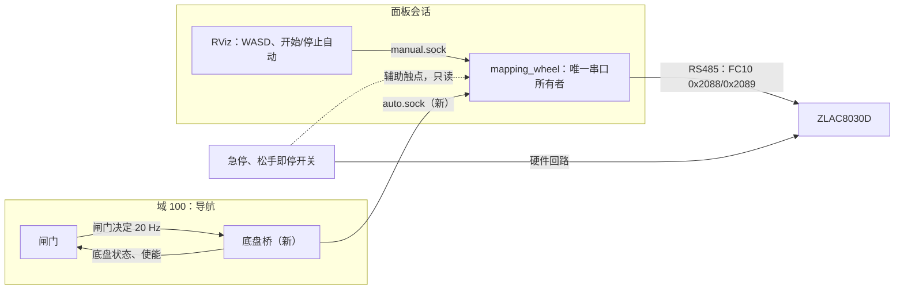

# 导航到电机的速度通道（设计）
把安全闸门的输出 `/wc_nav/cmd_vel_gated` 经现有轮控所有者下发到 ZLAC8030D 的设计。用户 2026-11-09 同意按本稿做，包括第 4 节切换规则、第 5 节上限和第 8 节分级；[接口约定](../reference/interface_contract.md)里"不发送任何电机或导航命令"那一条，第 2 级（架空）之前再请用户定。写本文时没有写会写设备的代码，没有连驱动器，没有发任何速度指令。代码现状按 2026-11-09 的 A 分支 40f76a88、D 分支 21fb9459（闸门）、B 分支 3cd54e19（Nav2 参数）读出。ZLAC8030D 手册、急停硬件和乘坐舒适限值由新成员调研，结果出来后补进第 5、7、8、10 节。

## 1. 结论
1. 车上现在没有任何一种停车方式实测过。代码和配置里写明：USB/RS485 断线后驱动器停不停、驱动器有没有看门狗、多长时间，都不知道；用户只确认过旧 WASD 能开、零速能保持、WiFi 或遥控断开会停。实车接通前必须先有三样并实测通过：物理急停、松手即停的使能开关、驱动器自己的失联停车（没有的话用硬件看门狗代替）。
2. 串口只归一个进程：面板会话里的 `wc_runtime.mapping_wheel`。导航不开串口，经一个新的"底盘桥"进程把闸门输出交给它。手动（RViz 里的 WASD）和自动由它仲裁，任何切换都先写零速、看到轮速连续为零再换。
3. 速度硬上限放在轮控所有者里（离电机最近，不依赖 ROS），上游 Nav2、碰撞监控、闸门照旧各限一层。第一次自动闭环用 0.10 m/s，制动距离实测通过后再到 0.30 m/s。任何一层收到负线速度都当作故障停车，不倒车。
4. 要用户回答车上现有硬件的问题（7.3 节），要 D 审第 9 节的接口。

## 2. 现状（读代码）
### 2.1 轮控所有者
- 进程：面板的实时建图或"数据录制"会话带轮反馈、人工驾驶时，会话启动 `python -m wc_runtime.mapping_wheel`（[mapping_wheel.py](../../src/wc_runtime/mapping_wheel.py)），它是这个会话唯一的轮串口所有者。串口用 wc_motion 的 `FeedbackSerialLease` 打开（[feedback_transport.py](../../src/wc_motion/feedback_transport.py)）：共享锁文件加 `flock`、`TIOCEXCL`，再查没有别的进程打开，跨工作区有效。设备 `/dev/smartwheel_zlac8030`（CH34x USB 转 485，115200 波特，从站 1）。
- 读：每 0.1 s 用 FC03 读一次 0x20AB/0x20AC（两轮实际转速），发布 `/wc_mapping/wheel/feedback_raw` 并写进录包。一次只做一个 RTU 交换，超时 80 ms；出错不重试、不重连，进入 FAULT。
- 写（只在用户按 WASD 时）：第一次非零按键先做旧程序的初始化：0x200D=3、0x200F=0、0x200E=6，等 0.2 s，速度清零，0x200E=8，等 0.2 s。之后每 0.05 s 用 FC10 写 0x2088/0x2089（左右目标转速，旧程序的比例 8.9 寄存器/rpm）。松键先写零速，连续 3 次读到两轮为 0 才算停稳；空闲后写 0x200E=7 释放伺服，供手推。这些寄存器的含义都来自旧程序，没有独立核实。
- 手动输入：RViz 里的 WASD 经本机 Unix socket 进来（同 UID、单客户端、会话编号、递增序号）。按键 0.25 s 没刷新就停，界面心跳 0.25 s 没刷新就停。限速 0.10 m/s、0.20 rad/s；配置上限 0.15 m/s、0.30 rad/s，每轮 30 rpm。可以按 S 后退。细节见[运行限制](../operations/runtime_limits_zh.md)。
- 退出：会话结束时最多约 0.9 s 等零速停稳；通信出错时只补发一次零速，不当作已确认。会话进程由带 PDEATHSIG 的包装器管理（`wc_runtime/component.py`）：面板退出时先给它发 SIGINT，它写零速、等停稳再退出；宽限时间过了才升级到 SIGTERM、SIGKILL（建图会话的宽限是 120 s）。被 SIGKILL 或卡死时不会再发零速。
- wc_motion 里另有 [manual_hardware.py](../../src/wc_motion/manual_hardware.py)：独立的 WASD 工具，面板不用。它在实机运行前要一份审定的证据文件，证明命令寄存器和方向、断线停车、零速保持、物理停车和抱闸都实测过，还要回读固件、使能、速度模式、看门狗、停车策略。[证据模板](../../config/wheel_manual_stop_evidence.template.json)至今全是 false 或 null。自动通道要的证据和它一样，只多制动距离。
- [hardware_setup.json](../../config/hardware_setup.json) 的 `manual_controls` 记着用户说过的情况：旧 WASD 能开、零速保持制动、WiFi 或遥控断开会停；USB/RS485 断线停车、固件身份、硬件看门狗时长都没确认。

### 2.2 导航一侧
- 速度链路（[总体框架](autonomy_framework.md)）：RPP → `/cmd_vel_nav` → 速度平滑器 → 碰撞监控 → `/cmd_vel_monitored` → 闸门 → `/wc_nav/cmd_vel_gated`。没有进程发 `/cmd_vel`。
- 闸门（D，[safety_gate.py](../../src/wc_navigation/autonomy/safety_gate.py)、[gate_node.py](../../src/wc_navigation/autonomy/gate_node.py)；链接是本分支的旧版，下面按 D 分支的新版）：每 0.05 s 发一条 `geometry_msgs/Twist`。急停锁存、使能（`/wc_nav/enable`，Bool）超过 1.0 s 没刷新、定位不可信、命令超过 0.5 s 没更新时发零。线速度截到 0.30 m/s、角速度截到 0.50 rad/s，负线速度改成 0。状态 JSON 发在 `/wc_nav/gate_status`，2 Hz 加每次状态变化。闸门不限加速度。
- Nav2 参数（B）：RPP 0.30 m/s，原地转向 0.4 rad/s，不倒车。平滑器开环，加速 0.30 m/s²、减速 0.60 m/s²、角加速度 0.80 rad/s²，最小线速度 0。碰撞监控停车区在车体外 2 cm，"接近"模型前瞻 1.2 s。
- 实车影子链路（D，集成分支的 `docs/architecture/live_shadow.md`）：导航在域 100（只本机），面板在域 83。单向转发只读三个传感器话题，导航从不在面板域发布。闸门输出现在没有订阅者，影子运行的检查单要求确认这一点。
- [接口约定](../reference/interface_contract.md)写着"不发送任何电机或导航命令"。接通前要用户决定改这一条。

## 3. 通道结构

- 底盘桥：在域 100 里订阅闸门决定，经本机 Unix socket 交给轮控所有者，再把轮控所有者的状态发回域 100。它不开串口，不在面板域发布，不改速度，只转发和计时。
- 为什么用 socket：D 的单向转发是按"导航不在面板域发布"设计的（上车前由总管和用户评审）。socket 自带连接存活、同 UID、单客户端和会话绑定；轮控所有者的手动 socket 已经是这套写法，断开立刻能发现，不靠 DDS 发现和 QoS。
- 不建议的两种做法：(a) 轮控所有者在进程里再开一个域 100 的 ROS 上下文直接订阅，少一个进程，但串口所有者会依赖导航域的发现，出问题时分不清是哪边；(b) 加一个反向转发进程在面板域发布，违背上面这条设计原则。
- 默认断开：会话冻结的配置里没有 `auto_controls`，或者没有用户当次同意（例如环境变量 `WC_AUTO_DRIVE_APPROVAL=APPROVED_BY_USER_<日期>`，写法和 D 的实车影子一样），轮控所有者就不建 `auto.sock`，行为和现在完全一样。"制动距离实测通过前保持断开"靠的就是这一条。允许的最高速度取配置和证据文件（第 8 节）里较小的那个，提速要有新的证据。

## 4. 手动和自动：谁占串口、怎么切换
- 串口始终只归 mapping_wheel。手动和自动是它内部的两个控制源，同一时刻最多一个，只按当前控制源写速度。状态：`NONE`（只读或零速保持）、`MANUAL`（现有 WASD 和手推）、`AUTO`、`STOPPING`、`FAULT`。
- 进入自动，下面全部满足才进：
  1. 本会话允许自动，底盘桥已连上，最近 0.3 s 内有闸门决定；
  2. 闸门决定里报的线、角速度上限不高于轮控所有者的批准上限（第 5 节）；
  3. 操作员在界面上点"开始自动"（手动 socket 加一种包，和按键一样校验序号和代号）；
  4. 急停没按下，物理使能开关按住。开关的辅助触点必须读得到，读不到就不进自动；
  5. 没有按着的 WASD；
  6. 轮速反馈连续 0.5 s 为 0（5 个新样本）；伺服已经释放（手推中）时，先按现有初始化顺序重新上使能，目标保持 0；
  7. 驱动器参数回读和审定值一致、没有故障码（第 5 节）。
  进了自动，速度从 0 按加速度上限爬升，不会跳到闸门当时的值。
- 退出自动，任一条：
  - 操作员：按任何 WASD 键或空格（接管）、点"停止自动"、松开使能开关、按急停；
  - 连接：界面断开或心跳 0.25 s 没刷新，底盘桥断开，闸门决定 0.3 s 没刷新；
  - 闸门状态是急停锁存；
  - 设备：串口或驱动器故障；
  - 数值：收到超限、负线速度或非有限数；轮速和指令对不上（指令为零 1 s 后还在转，或车往后走超过 0.2 s）。
- 退出时先写零速（按第 5 节的减速度），等连续 3 次轮速为 0，1 s 内停不下来就进 FAULT；然后回到 `NONE`，保持伺服，不自动释放手推。
- 闸门因为定位不可信等原因发零时，不退出自动：车停住等，闸门放行后按加速度上限重新起步（例如定位修正突变后稳定 3 s 恢复，这是用户批准的闸门默认）。陪同者一直按着使能开关，随时可以松手。
- 接管键只当停车用：停稳后要松开再按才动，防止按着的键在停稳那一刻直接把车开走。
- 回到手推：和现在一样要新鲜的前台界面意图；自动退出后的第一次释放必须是用户明确的手推请求，防止在坡上一退出自动就松开伺服溜车。
- 导航自己不能选自动，只能在操作员选了自动之后提供速度。

## 5. 速度、加速度和倒车
| 层 | 线速度 | 角速度 | 加速度 | 倒车 | 谁维护 | 怎么核对 |
|---|---|---|---|---|---|---|
| Nav2 控制器 RPP | 0.30 m/s | 原地转 0.4 rad/s | 不限 | `allow_reversing=false` | B | 启动时参数读回（D 的影子启动器已做） |
| 速度平滑器 | ≤ 0.30 | ≤ 0.50 | 加 0.30、减 0.60 m/s²；角 0.80 rad/s² | 最小 0 | B | 同上 |
| 碰撞监控 | 停车区车体外 2 cm，减速区 ×0.4，接近模型 1.2 s | 同左 | — | — | B、C | 录包影子运行 |
| 闸门 | 截到 0.30 | 截到 0.50 | 不限 | 负值改 0 | D | 单元测试；`gate_status` 计数 |
| 轮控所有者（新） | 硬上限：第一次 0.10，实测后 0.20、0.30 | ≤ 0.50（第一次 0.30） | 加 ≤ 0.30 m/s²，软件减速 ≤ 0.60 m/s²，角 ≤ 0.80 rad/s² | 负值当故障，退出自动 | A | 见下 |
| ZLAC8030D | 最大转速参数（若有） | | 加减速时间参数 | | A，按手册 | 进自动前只读回读 |

- 每轮转速另限 27 rpm：0.30 m/s 加 0.50 rad/s 时外侧轮 0.45 m/s，轮半径 0.1646 m 下是 26.1 rpm。
- 三层上限要一致：Nav2 和闸门的上限设成不高于轮控所有者的批准上限，第一次闭环三层都用 0.10 m/s、0.30 rad/s（RPP 的原地转向随之变成 0.30 rad/s）。闸门决定里带着当时的上限，进自动时核对（第 4 节）。
- 超限不截断：线速度比上限多 5 mm/s 以上、角速度多 0.01 rad/s 以上、负线速度、非有限数，都当作上游故障，退出自动并停车。上限一致时闸门不会发这些值，出现就说明链路坏了。
- 轮控所有者一定要有加速度斜坡：平滑器是开环的，闸门停车期间 Nav2 的输出可能已经是 0.30；闸门一放行，闸门输出会从 0 跳到 0.30。软件停车也按 0.60 m/s² 减速，0.30 m/s 约 0.5 s 停住。舒适限值出来后再定这三个数。
- 驱动器一层：加减速时间、最大转速、通讯中断时间，进自动前只读回读，和证据文件里的审定值不一致就不进自动。只读不改；要改参数，先写清怎么改、怎么改回，用户同意后单独做。
- 怎么核对：
  1. 单元测试（假串口，不接设备）：超限、负值、NaN、过期、断开、跳变各种输入下，写出的 FC10 字从不超过上限，斜坡对，每个退出条件都先写零、等停稳。
  2. 拿实车影子运行记下的闸门输出离线喂给限速器，数截断和违规次数，违规应为 0。
  3. 架空：测试指令源（不是 Nav2）发 0.05、0.10 m/s 和左右转，看轮速反馈；再发 0.5 m/s、−0.05 m/s，确认退出自动并停车。指令和反馈的速度比要在 ±3% 内（指令比例 8.9 来自旧程序，没核实过）。
  4. 落地：按第 8 节在地上量实际速度（地上标线、雷达到前方墙的距离，方法同[现场补录](../operations/field_site_checks.md)第 3 项），和反馈比。
  5. 事务日志记下每条命令截前、截后的值、来源序号和闸门状态，事后能逐条核。

## 6. 出事时怎么停
| 情况 | 谁先发现 | 靠谁停 | 现在的证据 |
|---|---|---|---|
| 闸门发零（定位不可信、使能过期、急停锁存、命令过期） | 闸门 | 我们发零速：闸门 → 桥 → 轮控所有者 → 驱动器 | 仿真有，实车没有 |
| 导航进程（Nav2、闸门）卡住或退出 | 闸门（命令过期）或轮控所有者（闸门决定 0.3 s 没刷新） | 我们发零速，退出自动 | 没有 |
| 底盘桥退出、socket 断开 | 轮控所有者，立即 | 我们发零速，退出自动 | 没有 |
| 面板界面崩溃、远程桌面断线 | 轮控所有者（手动 socket 断开或心跳 0.25 s） | 我们发零速，退出自动 | 手动已有，自动没有 |
| 面板主程序退出 | 会话包装器 | 轮控所有者收到 SIGINT 后发零速；它要是卡住，宽限期后被 SIGKILL，之后只能靠下面几行 | 只读过代码 |
| 松开使能开关 | 硬件；轮控所有者读辅助触点 | 硬件切断驱动器使能或动力，软件同时发零、退出自动 | 没有硬件 |
| 按下急停 | 硬件 | 硬件切断；软件发现后锁存，复位要松开急停并重新点"开始自动" | 没有硬件，待用户答 |
| 轮控所有者崩溃、被 SIGKILL、卡死 | 驱动器（通讯中断保护）或硬件看门狗 | 驱动器自己停；没有这个功能就只剩急停和使能开关 | 不知道驱动器有没有、多长时间 |
| USB 转 485 拔掉、线断 | 同上 | 同上 | 同上，从没确认过 |
| Orin 死机或掉电 | 同上 | 同上；驱动器和 Orin 共用电源时驱动器一起断电，电机没有力矩，有没有抱闸决定会不会溜 | 同上，待用户答电源 |
| 驱动器报故障、欠压 | 驱动器；轮控所有者低频读故障码（新增） | 驱动器自己停；软件退出自动并锁存 | 故障码寄存器待手册 |
| 轮速和指令对不上 | 轮控所有者 | 发零速，进 FAULT | 没有 |
| 动力电池断电 | 无 | 电机没有力矩：有抱闸则停，没有可能滑行或溜坡 | 待用户答 |

- 正常停车靠我们发零速，快而且平顺，但要求轮控所有者、串口、驱动器都活着。
- 软件死掉（进程、USB、Orin）只能靠驱动器自己的通讯中断保护。它是不是"一段时间没收到任何帧就停"，读命令算不算，停的方式（减速停、急停、失能自由转），都要从手册查、架空实测。没有这个功能，就要加硬件看门狗继电器：轮控所有者经 USB 数字口周期性喂狗，停喂就断开驱动器使能。
- 急停和使能开关不经过任何软件，任何情况都能停，是主要的安全手段。软件各层在实测之前一律不算安全措施。
- 驱动器的通讯中断时间要比轮控所有者的写周期（0.05 s）长得多、又不能太长，暂定 0.2–0.3 s，看手册允许的范围。自动期间轮控所有者每 0.05 s 都写一次（零速也写），保证驱动器始终收到新鲜指令。
- 指令链延迟预算 ≤ 0.15 s：闸门一个周期 0.05 s，桥几毫秒，轮控所有者最多等一个 80 ms 的读交换，写一帧约 2 ms。架空时用事务日志里闸门时间戳到写入时间实测。

## 7. 急停和松手即停的硬件
### 7.1 接法建议
- 急停：红色蘑菇头自锁按钮，常闭触点，线断也等于急停。两个串联：乘坐者手边（扶手）一个，推把上陪同者一个。接法按手册二选一：
  - 接驱动器的急停或使能输入（如果 ZLAC8030D 有，并能设成"断开即停"）：停车方式由驱动器决定，最好是先减速再断动力；驱动器不断电，状态读得到。
  - 串在驱动器动力电源的直流接触器线圈回路里：按下就切断电机电源，最简单可靠；但电机马上没有力矩，有没有电磁抱闸决定车会不会滑行，接触器要按电机电压和电流选。
- 松手即停：推把上的握把式开关或三位使能开关，按住闭合、松手断开，串在急停回路里（硬件停）。另取一路辅助触点给软件读（必须有），用来做两件事：按住才允许进自动；`/wc_nav/enable` 心跳由开关状态生成，不再由监督进程的定时器发。读法二选一：驱动器的数字输入如果能经 Modbus 读出，就不用加设备；否则加一个 USB 数字 IO 模块。无线遥控的死人开关也可以，但要确认信号丢失时继电器断开。
- 失联停车：先用驱动器的通讯中断保护（要写驱动器参数，用户同意后单独做）；没有的话加 6 节说的硬件看门狗继电器，串在使能回路里。
- 自动行驶时加一个灯或蜂鸣器，让周围的人知道车在自己走（可选）。

### 7.2 可能要买的东西
| 东西 | 数量 | 用途 |
|---|---|---|
| 自锁急停按钮（常闭触点） | 2 | 乘坐者、陪同者各一个 |
| 握把式或三位使能开关（带辅助触点） | 1 | 松手即停，同时给软件读 |
| 安全继电器或直流接触器 | 1 | 按电机电源的电压和电流选，接法定了再买 |
| USB 数字 IO 模块 | 0–1 | 驱动器输入读不出来时，用来读开关状态、喂看门狗 |
| 硬件看门狗继电器模块 | 0–1 | 驱动器没有通讯中断保护时 |
| 线材、保险丝、端子 | 若干 | |

### 7.3 问用户：车上现在有什么
1. 车上有没有急停按钮？在哪？按下切断什么（整车电源、电机电源、驱动器使能）？
2. 有没有按住才走、松手即停的开关？原厂摇杆控制器还接着吗？
3. 电机有没有电磁抱闸？断电时轮子是锁住还是能推？现在手推靠的是软件释放伺服（0x200E=7），还是抱闸上的手柄？
4. Orin 和 ZLAC8030D 是不是同一块电池？电压多少？有没有总开关、钥匙、保险？Orin 关机或死机时驱动器还有没有电？
5. ZLAC8030D 的输入端子现在接了什么？驱动器标签上的型号、固件或硬件版本是什么？
6. 以前说的"WiFi 或遥控断开会停"是哪套系统、怎么做到的（软件发零还是硬件）？那个遥控器还在吗？
7. 试验场地：有没有能临时封闭的走廊段？地面坡度大概多少？谁当陪同者？
8. RS485 线上除了 ZLAC8030D 还有没有别的设备？（超声波在另一条 9600 波特的线上。）

## 8. 接通前的证据和第一次通电
### 8.1 分级和通过线
每一级都要用户当次同意（带日期），结果写进新的证据文件（结构仿照 manual_hardware 的证据，多制动距离；每个来源文件记 sha256、审核人、日期）。上一级没通过不进下一级。

| 级 | 内容 | 通过线 |
|---|---|---|
| 0 离线 | 代码评审；单元测试（假串口）覆盖第 4、5、6 节每一条；影子运行的闸门输出离线过限速器；D 审接口；用户决定改接口约定 | 测试全过；违规 0 |
| 1 只读设备 | 按手册只读驱动器的固件、加减速时间、最大转速、通讯中断设置、故障码、输入状态，记进证据文件 | 读到的值都有手册解释 |
| 2 架空 | 车垫高、驱动轮离地、无人乘坐，急停和使能开关已装（步骤见 8.2） | 下面 a–g 每项 3 次都按预期停；失联类停下的时间 ≤ 驱动器通讯中断时间 + 0.5 s；没有一次在停稳前换了控制源 |
| 3 落地制动 | 空车，陪同者握使能开关跟车，测试指令源按 0.10、0.20、0.30 m/s 逐级；每种停车方式（软件零速、失联、急停、松手）每档 5 次；之后经用户同意加配重或乘坐者再测 | 暂定：软件零速在 0.30 m/s 时停车距离 ≤ 0.18 m（含延迟），急停、失联 ≤ 0.30 m；5 次的离散 ≤ 20%；停车时航向变化 ≤ 5°；减速度不超过舒适限值 |
| 4 监督闭环 | 框架验证阶梯第 5 级：封闭走廊、空车、陪同者握使能开关跟车，按批准的速度和路线 | 由用户另定 |

- 测试指令源：只在第 2、3 级用的小工具，按固定的速度曲线（加速到目标、保持、在标线处触发停车）经底盘桥下发，不经 Nav2，也不受闸门的定位条件约束（架空时没有定位）。它要单独的当次同意，速度照样受轮控所有者的上限和全部退出条件约束。
- 制动距离用三种方法同时量：地上卷尺和标线配视频、轮速反馈、雷达到前方墙的距离。
- 0.18 m 的来历：碰撞监控"接近"模型在 0.30 m/s 时看 1.2 s，即前方 0.36 m，取一半作余量；它的停车区只在车体外 2 cm，靠停车区停是来不及的。实测停车距离交给 B、C 核对接近模型的前瞻和控制器的碰撞检查。
- 第 2 级的检查项：
  - a. 用现有手动通道（0.10 m/s）让轮子转，按急停、松使能开关，轮子停；
  - b. 轮子转着时 `kill -9` 轮控所有者，轮子停（这是失联停车的关键证据）；
  - c. 轮子转着时拔 USB 转 485；
  - d. 轮子转着时断 Orin 电源。正在写的录包和数据盘有损坏风险：这一项单独做，先备份数据根里要紧的东西，只记视频和轮子的表现；
  - e. 停闸门、停底盘桥、停 Nav2，软件零速；
  - f. 自动通道用测试指令源：前进、左右转、负速度、超限，各自按第 5 节的预期；
  - g. 自动中按 WASD、空格，先停稳再交给手动；手动中请求自动，要停稳才进。

### 8.2 第一次通电（架空）
1. 车体垫高，两个驱动轮离地 ≥ 2 cm，垫块不会滑；轮子周围没人没东西。
2. 急停和使能开关接好后，先不通电，用万用表确认按下急停、松开使能时回路断开。
3. 在面板开常规录制（轮控所有者、反馈和录包都在），先只读：轮速反馈约 10 Hz，全为 0。
4. 按第 1 级只读驱动器参数，和证据文件核对。
5. 用现有手动通道（0.10 m/s）点动一次，确认方向和轮速反馈；按急停，确认停；复位。
6. 依次做第 2 级的 a–g，每一步之后看轮速反馈和事务日志，记下停车时间。
7. 结束：停止录制，先断驱动器动力，再关 Orin。

## 9. 和 D 的接口（请 D 审）
### 9.1 现在
| 话题 | 类型 | 频率 | 方向 |
|---|---|---|---|
| `/wc_nav/cmd_vel_gated` | `geometry_msgs/Twist` | 20 Hz，不放行时为零 | 闸门发出，现在没有订阅者 |
| `/wc_nav/gate_status` | `std_msgs/String`（JSON：`time_s`、`state`、`reasons`、`previous_state`、`counts`、`map_correction_events`、`linear`、`angular`，有 AMCL 时加 `stationary_relocalization`） | 2 Hz 加状态变化，transient local | 闸门发出 |
| `/wc_nav/enable` | `std_msgs/Bool` | 监督进程 4 Hz | 闸门订阅，1.0 s 超时 |
| `/wc_nav/estop` | `std_msgs/Bool` | 事件 | 闸门订阅，锁存；复位要先松开、再来新的使能 |

### 9.2 建议
1. 闸门每个周期多发一条带序号和状态的决定，例如 `/wc_nav/gate_command`（`std_msgs/String`，JSON，和 `gate_status` 同风格，以后也可以换自定义消息），字段：`schema`、`seq`（递增）、`stamp_ns`（节点时钟，实车是墙钟）、`mono_ns`（`time.monotonic_ns()`，同一台 Orin 上判新鲜度用）、`state`、`reasons`、`linear`、`angular`、`limits`（当时生效的线、角速度上限，包括 D 在做的横向判据降速档）、`config_sha256`。桥只转发这一条，不转发裸 Twist；`cmd_vel_gated` 照发，给记录器和现有工具用。速度和状态分在两个话题上会有先后，2 Hz 的状态也太慢，合成一条才能逐条核对"放行时才有非零速度"。
2. 实车上 `/wc_nav/enable` 改由桥按物理使能开关的状态发：开关按住时 4 Hz 发 true，松开就不发。闸门的使能超时建议实车用 0.5 s；轮控所有者在开关松开时已经立即停车，闸门这层是附加的。
3. 物理急停读得到时，`/wc_nav/estop` 也由桥按急停状态发；面板上的软件急停按钮照样可以发 true。
4. 新话题 `/wc_nav/base_status`（桥发，`std_msgs/String` JSON，10 Hz）：控制源（NONE/MANUAL/AUTO）、状态和原因、最后写出的线速度、角速度和两轮 rpm、截断和违规计数、反馈的两轮速度、是否停稳、使能开关、急停、驱动器故障、串口状态、闸门决定的年龄、会话编号、当前上限。桥 0.3 s 收不到轮控所有者的状态时报 `BASE_STATUS_STALE`。建议闸门把"底盘不在 AUTO"记成原因（例如 `BASE_NOT_AUTO`）并输出零，记录里就能看出车为什么没动。
5. 闸门的命令超时 0.5 s 在 0.30 m/s 时多走 0.15 m。Nav2 控制器 10 Hz、平滑器 20 Hz，建议实车用 0.3 s，请 D 评估。
6. 时间和 QoS：闸门在实车上用墙钟（`use_sim_time` false）；新鲜度由轮控所有者用单调钟判断，同时看消息里的 `mono_ns` 和桥收到的时间。桥订阅 `gate_command` 用 reliable、keep last 1、volatile，只要最新一条。
7. 给 B 的一条：平滑器开环，闸门停车时它的输出不会回零，闸门一放行就是跳变。轮控所有者的斜坡能挡住，但最好在 Nav2 一侧也处理（例如实车用闭环反馈 `/odom`，或闸门放行时让平滑器从当前速度起步），请 B 看。

## 10. 待新成员从手册核对的问题
1. RS485 通讯中断保护：有没有，寄存器、单位、范围、默认值；超时后怎么停（减速停、急停、失能后自由转）；读命令算不算通讯；触发后要不要复位，能不能自动恢复。
2. 控制字 0x200E 各值（5、6、7、8 等）的确切含义：7 是"停止"还是"失能"；失能后电机是自由转还是短路制动。
3. 0x200D=3、0x200F=0 的含义（速度模式？同步、异步？）。
4. 速度指令 0x2088/0x2089 和反馈 0x20AB/0x20AC 的单位（代码里是 8.9 寄存器/rpm 和 0.112 rpm/寄存器，来自旧程序）。
5. 加速时间、减速时间、急停减速时间、最大转速的寄存器、单位、范围、默认值。
6. 故障码寄存器、报警复位方式，欠压和过流时的行为。
7. 外部输入端子（急停、使能等）的功能、接法，输入状态能不能经 Modbus 读出。
8. 电磁抱闸：驱动器能不能控制抱闸，失能和掉电时抱闸是什么状态。
9. 写进去的参数掉电后是否保存，写入次数有没有限制。
10. 舒适限值：轮椅乘坐者能接受的线加速度、减速度、角速度和角加速度，正常行驶和紧急停车分开给。
11. 急停硬件：按钮、使能开关、安全继电器的选型，以及先减速再断电和直接断电两种停车方式的取舍。

## 11. 审过以后的做法（建议）
- 分工（总管 2026-11-09 按建议定）：A 写轮控所有者的自动控制源、底盘桥、测试、证据文件格式，以及 RViz 面板的"开始自动""停止自动"和状态显示（wc_bringup 归 A）；D 审第 9 节，按 9.2 改闸门；B 看平滑器在闸门放行时的跳变；C 用实测停车距离核对碰撞监控的余量。
- 改动范围：`wc_runtime/mapping_wheel.py` 加自动控制源和 `auto.sock`，默认不建；新的底盘桥进程；`hardware_setup.json` 加默认关闭的 `auto_controls`；新的证据文件格式；接口约定改一条。手动驾驶、手推和录包的现有行为不变。
- 顺序：第 0 级代码和测试 → 用户审代码 → 硬件到位 → 第 1–3 级 → 用户同意后第 4 级。

第 0 级的实现（2026-11-09，A；只用假串口测过，没连驱动器）：
- 自动控制源在新文件 [mapping_auto.py](../../src/wc_runtime/mapping_auto.py)。[mapping_wheel.py](../../src/wc_runtime/mapping_wheel.py) 只加挂接（+24/−3 行）：没有挂接时手动驾驶、手推和录包的行为不变。会话冻结配置里没有 `auto_controls` 就不挂接。现在没有配置生成器写它，`hardware_setup.json` 也没加，等第 1 级做完开关读入和参数回读再定。
- 写了 `auto_controls` 也要下面几条全满足才建 `auto.sock`：`allowed` 为 true；有当天的 `WC_AUTO_DRIVE_APPROVAL=APPROVED_BY_USER_<YYYYMMDD>`；证据文件通过；上限自洽；有使能开关和急停的读入；能回读驱动器参数。车上现在没有后两样，所以自动控制在车上跑不起来。
- 消息格式在 [auto_protocol.py](../../src/wc_motion/auto_protocol.py)。桥只接受 `wc_gate_command_v1`，字段正好是 9.2 第 1 条那些，多一个、少一个都拒绝：`limits` 写成 `{"max_linear": …, "max_angular": …}`；`seq`、`stamp_ns` 是非负整数，`mono_ns` 是正整数；`state` 以大写字母开头，只含大写字母、数字和下划线，至多 48 个字符；`reasons` 是至多 16 条的短字符串列表；`config_sha256` 是 64 位小写十六进制或 null。只有 `ACTIVE` 可以带非零速度；其他状态带非零速度、负线速度、超过批准上限 0.005 m/s 或 0.01 rad/s 以上，都按软件减速上限停车并退出自动，不截断了照走。
- 证据格式在 [auto_evidence.py](../../src/wc_motion/auto_evidence.py)，模板 [wheel_auto_drive_evidence.template.json](../../config/wheel_auto_drive_evidence.template.json) 总被拒绝。分三个阶段：`STAND_TEST`（架空，上限不超过 0.10 m/s、0.30 rad/s，要第 2 级 a–d 的停车记录：急停、松开使能、杀轮控所有者、拔 USB、断 Orin 电源）、`GROUND_TEST`（再加 e 软件零速和 f–g 自动通道架空检查）、`SUPERVISED_CLOSED_LOOP`（再加批准最高速度下四种停车方式的制动记录，每种至少 5 次，过 8.1 的通过线）。来源文件记路径和 sha256，只能在本检出或数据根里。第 3 级按 0.10、0.20、0.30 m/s 逐级和第一次闭环用 0.10 m/s、0.30 rad/s，靠用户审证据里的 `approved_limits`，代码不分档。
- 底盘桥在 [auto_bridge.py](../../src/wc_motion/auto_bridge.py)：只在 `ROS_DOMAIN_ID=100`、`ROS_LOCALHOST_ONLY=1` 且有当天同意时启动；丢掉超过 0.3 s 或来自未来 50 ms 以上的闸门决定；`auto.sock` 断了就退出，不重连；`/wc_nav/enable` 只在轮控所有者 0.3 s 内的状态报"使能开关按住、没有急停"时按 4 Hz 发。
- 还没做：RViz 面板的"开始自动""停止自动"和状态显示（C++ 面板要重编，等用户审完代码再做）；开关读入和驱动器参数回读（第 1 级以后）。

返回[系统设计](README.md)。
