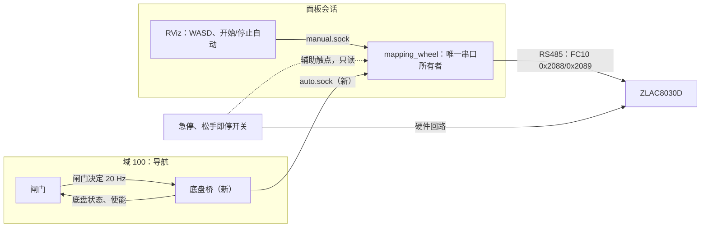

# 导航到电机的速度通道（设计）
把安全闸门的输出 `/wc_nav/cmd_vel_gated` 经现有轮控所有者下发到 ZLAC8030D 的设计。用户 2026-11-09 同意按本稿做，包括第 4 节切换规则、第 5 节上限和第 8 节分级；[接口约定](../reference/interface_contract.md)里"不发送任何电机或导航命令"那一条，第 2 级（架空）之前再请用户定。写本文时没有写会写设备的代码，没有连驱动器，没有发任何速度指令。代码现状按 2026-11-09 的 A 分支 40f76a88、D 分支 21fb9459（闸门）、B 分支 3cd54e19（Nav2 参数）读出。ZLAC8030D 手册、急停硬件和乘坐舒适限值由新成员调研，结果出来后补进第 5、7、8、10 节。2026-11-09 晚：D 审完第 9 节（D.md 18:45），9.2 改成定下的接口；第 7 节按当晚现场看到的车上硬件改写。

## 1. 结论
1. 车上现在没有任何一种停车方式实测过。代码和配置里写明：USB/RS485 断线后驱动器停不停、驱动器有没有看门狗、多长时间，都不知道；用户只确认过旧 WASD 能开、零速能保持、WiFi 或遥控断开会停。实车接通前必须先有三样并实测通过：物理急停、松手即停的使能开关、驱动器自己的失联停车（没有的话用硬件看门狗代替）。11-09 现场看到：座下有急停，接在驱动器 J4，最可能只让驱动器停车、不断电机电源；没有松手即停开关；USB 转 485 当晚从 USB 上掉线 36 次（第 7.1 节），失联是实际会发生的情况。
2. 串口只归一个进程：面板会话里的 `wc_runtime.mapping_wheel`。导航不开串口，经一个新的"底盘桥"进程把闸门输出交给它。手动（RViz 里的 WASD）和自动由它仲裁，任何切换都先写零速、看到轮速连续为零再换。
3. 速度硬上限放在轮控所有者里（离电机最近，不依赖 ROS），上游 Nav2、碰撞监控、闸门照旧各限一层。第一次自动闭环用 0.10 m/s，制动距离实测通过后再到 0.30 m/s。任何一层收到负线速度都当作故障停车，不倒车。
4. D 已审第 9 节，接口按 9.2 定下。车上硬件：下次现场按 7.3 节确认急停接法（架空、先 sync、只读），按 7.5 节采购松手即停开关等。

## 2. 现状（读代码）
### 2.1 轮控所有者
- 进程：面板的实时建图或"数据录制"会话带轮反馈、人工驾驶时，会话启动 `python -m wc_runtime.mapping_wheel`（[mapping_wheel.py](../../src/wc_runtime/mapping_wheel.py)），它是这个会话唯一的轮串口所有者。串口用 wc_motion 的 `FeedbackSerialLease` 打开（[feedback_transport.py](../../src/wc_motion/feedback_transport.py)）：共享锁文件加 `flock`、`TIOCEXCL`，再查没有别的进程打开，跨工作区有效。设备 `/dev/smartwheel_zlac8030`（CH34x USB 转 485，115200 波特，从站 1）。
- 读：每 0.1 s 用 FC03 读一次 0x20AB/0x20AC（两轮实际转速），发布 `/wc_mapping/wheel/feedback_raw` 并写进录包。一次只做一个 RTU 交换，超时 80 ms；出错不重试、不重连，进入 FAULT。
- 写（只在用户按 WASD 时）：第一次非零按键先做旧程序的初始化：0x200D=3、0x200F=0、0x200E=6，等 0.2 s，速度清零，0x200E=8，等 0.2 s。之后每 0.05 s 用 FC10 写 0x2088/0x2089（左右目标转速，旧程序的比例 8.9 寄存器/rpm）。松键先写零速，连续 3 次读到两轮为 0 才算停稳；空闲后写 0x200E=7 释放伺服，供手推。这些寄存器的含义都来自旧程序，没有独立核实。
- 手动输入：RViz 里的 WASD 经本机 Unix socket 进来（同 UID、单客户端、会话编号、递增序号）。按键 0.25 s 没刷新就停，界面心跳 0.25 s 没刷新就停。限速 0.10 m/s、0.20 rad/s；配置上限 0.15 m/s、0.30 rad/s，每轮 30 rpm。可以按 S 后退。细节见[运行限制](../operations/runtime_limits_zh.md)。
- 退出：会话结束时最多约 0.9 s 等零速停稳；通信出错时只补发一次零速，不当作已确认。会话进程由带 PDEATHSIG 的包装器管理（`wc_runtime/component.py`）：面板退出时先给它发 SIGINT，它写零速、等停稳再退出；宽限时间过了才升级到 SIGTERM、SIGKILL（建图会话的宽限是 120 s）。被 SIGKILL 或卡死时不会再发零速。
- wc_motion 里另有 [manual_hardware.py](../../src/wc_motion/manual_hardware.py)：独立的 WASD 工具，面板不用。它在实机运行前要一份审定的证据文件，证明命令寄存器和方向、断线停车、零速保持、物理停车和抱闸都实测过，还要回读固件、使能、速度模式、看门狗、停车策略。[证据模板](../../config/wheel_manual_stop_evidence.template.json)至今全是 false 或 null。自动通道要的证据和它一样，只多制动距离。
- [hardware_setup.json](../../config/hardware_setup.json) 的 `manual_controls` 记着用户说过的情况：旧 WASD 能开、零速保持制动、WiFi 或遥控断开会停；USB/RS485 断线停车、固件身份、硬件看门狗时长都没确认。

### 2.2 导航一侧
- 速度链路（[总体框架](autonomy_framework.md)）：RPP → `/cmd_vel_nav` → 速度平滑器 → 碰撞监控 → `/cmd_vel_monitored` → 闸门 → `/wc_nav/cmd_vel_gated`。没有进程发 `/cmd_vel`。
- 闸门（D，[safety_gate.py](../../src/wc_navigation/autonomy/safety_gate.py)、[gate_node.py](../../src/wc_navigation/autonomy/gate_node.py)；链接是本分支的旧版，下面按 D 分支的新版）：每 0.05 s 发一条 `geometry_msgs/Twist`。急停锁存、使能（`/wc_nav/enable`，Bool）超过 1.0 s 没刷新、定位不可信、命令超过 0.5 s 没更新时发零。线速度截到 0.30 m/s、角速度截到 0.50 rad/s，负线速度改成 0。状态 JSON 发在 `/wc_nav/gate_status`，2 Hz 加每次状态变化，有 AMCL 时另有协方差一节（edfe001c 起）。命令输入是碰撞监控的输出 `/cmd_vel_monitored`，命令超时看的就是它，发非零速度时约 10 Hz。闸门基本不限加速度：只有 lateral 限速进出时，上限按 0.6 / 0.3 m/s² 过渡。
- Nav2 参数（B）：RPP 0.30 m/s，原地转向 0.4 rad/s，不倒车。平滑器开环，加速 0.30 m/s²、减速 0.60 m/s²、角加速度 0.80 rad/s²，最小线速度 0。碰撞监控停车区在车体外 2 cm，"接近"模型前瞻 1.2 s。
- 实车影子链路（D，集成分支的 `docs/architecture/live_shadow.md`）：导航在域 100（只本机），面板在域 83。单向转发只读三个传感器话题，导航从不在面板域发布。闸门输出现在没有订阅者，影子运行的检查单要求确认这一点。
- [接口约定](../reference/interface_contract.md)写着"不发送任何电机或导航命令"。接通前要用户决定改这一条。

## 3. 通道结构

- 底盘桥：在域 100 里订阅闸门决定，经本机 Unix socket 交给轮控所有者，再把轮控所有者的状态发回域 100。它不开串口，不在面板域发布，不改速度，只转发和计时。
- 为什么用 socket：D 的单向转发是按"导航不在面板域发布"设计的（上车前由总管和用户评审）。socket 自带连接存活、同 UID、单客户端和会话绑定；轮控所有者的手动 socket 已经是这套写法，断开立刻能发现，不靠 DDS 发现和 QoS。
- 不建议的两种做法：(a) 轮控所有者在进程里再开一个域 100 的 ROS 上下文直接订阅，少一个进程，但串口所有者会依赖导航域的发现，出问题时分不清是哪边；(b) 加一个反向转发进程在面板域发布，违背上面这条设计原则。
- 默认断开：会话冻结的配置里没有 `auto_controls`，或者没有用户当次同意（例如环境变量 `WC_AUTO_DRIVE_APPROVAL=APPROVED_BY_USER_<日期>`，写法和 D 的实车影子一样），轮控所有者就不建 `auto.sock`，行为和现在完全一样。"制动距离实测通过前保持断开"靠的就是这一条。允许的最高速度取配置和证据文件（第 8 节）里较小的那个，提速要有新的证据。

## 4. 手动和自动：谁占串口、怎么切换
- 串口始终只归 mapping_wheel。手动和自动是它内部的两个控制源，同一时刻最多一个，只按当前控制源写速度。状态：`NONE`（只读或零速保持）、`MANUAL`（现有 WASD 和手推）、`AUTO`、`STOPPING`、`FAULT`。
- 进入自动，下面全部满足才进：
  1. 本会话允许自动，底盘桥已连上，最近 0.3 s 内有闸门决定；
  2. 闸门决定里报的线、角速度上限不高于轮控所有者的批准上限（第 5 节），`allow_reverse` 为 false；
  3. 操作员在界面上点"开始自动"（手动 socket 加一种包，和按键一样校验序号和代号）；
  4. 急停没按下，物理使能开关按住。开关的辅助触点必须读得到，读不到就不进自动；
  5. 没有按着的 WASD；
  6. 轮速反馈连续 0.5 s 为 0（5 个新样本）；伺服已经释放（手推中）时，先按现有初始化顺序重新上使能，目标保持 0；
  7. 驱动器参数回读和审定值一致、没有故障码（第 5 节）。
  进了自动，速度从 0 按加速度上限爬升，不会跳到闸门当时的值。
- 退出自动，任一条：
  - 操作员：按任何 WASD 键或空格（接管）、点"停止自动"、松开使能开关、按急停；
  - 连接：界面断开或心跳 0.25 s 没刷新，底盘桥断开，闸门决定 0.3 s 没刷新，闸门换了来源（`gate_id` 变了，即闸门重启过）或 `seq` 不增；
  - 闸门状态是急停锁存；
  - 设备：串口或驱动器故障；
  - 数值：收到超限（包括超过闸门当时的 `linear_ceiling`）、负线速度或非有限数；轮速和指令对不上（指令为零 1 s 后还在转，或车往后走超过 0.2 s）。
- 退出时先写零速（按第 5 节的减速度），等连续 3 次轮速为 0，1 s 内停不下来就进 FAULT；然后回到 `NONE`，保持伺服，不自动释放手推。
- 闸门因为定位不可信等原因发零时，不退出自动：车停住等，闸门放行后按加速度上限重新起步（例如定位修正突变后稳定 3 s 恢复，这是用户批准的闸门默认）。陪同者一直按着使能开关，随时可以松手。
- 接管键只当停车用：停稳后要松开再按才动，防止按着的键在停稳那一刻直接把车开走。
- 回到手推：和现在一样要新鲜的前台界面意图；自动退出后的第一次释放必须是用户明确的手推请求，防止在坡上一退出自动就松开伺服溜车。
- 导航自己不能选自动，只能在操作员选了自动之后提供速度。

## 5. 速度、加速度和倒车
| 层 | 线速度 | 角速度 | 加速度 | 倒车 | 谁维护 | 怎么核对 |
|---|---|---|---|---|---|---|
| Nav2 控制器 RPP | 0.30 m/s | 原地转 0.4 rad/s | 不限 | `allow_reversing=false` | B | 启动时参数读回（D 的影子启动器已做） |
| 速度平滑器 | ≤ 0.30 | ≤ 0.50 | 加 0.30、减 0.60 m/s²；角 0.80 rad/s² | 最小 0 | B | 同上 |
| 碰撞监控 | 停车区车体外 2 cm，减速区 ×0.4，接近模型 1.2 s | 同左 | — | — | B、C | 录包影子运行 |
| 闸门 | 截到 0.30；lateral 限速时 0.15（决定里的 `linear_ceiling`） | 截到 0.50 | 基本不限（lateral 进出时 0.6 / 0.3 m/s²） | 负值改 0 | D | 单元测试；`gate_status` 计数 |
| 轮控所有者（新） | 硬上限：第一次 0.10，实测后 0.20、0.30 | ≤ 0.50（第一次 0.30） | 加 ≤ 0.30 m/s²，软件减速 ≤ 0.60 m/s²，角 ≤ 0.80 rad/s² | 负值当故障，退出自动 | A | 见下 |
| ZLAC8030D | 最大转速参数（若有） | | 加减速时间参数 | | A，按手册 | 进自动前只读回读 |

- 每轮转速另限 27 rpm：0.30 m/s 加 0.50 rad/s 时外侧轮 0.45 m/s，轮半径 0.1646 m 下是 26.1 rpm。
- 三层上限要一致：Nav2 和闸门的上限设成不高于轮控所有者的批准上限，第一次闭环三层都用 0.10 m/s、0.30 rad/s（RPP 的原地转向随之变成 0.30 rad/s）。闸门决定里带着当时的上限，进自动时核对（第 4 节）。闸门 `max_linear` 设成 0.10 时，lateral 默认的限速 0.15 比上限还高，GateConfig 会拒绝启动；实车配置要显式给 `--gate-slow-limits 0.50 0.05`（D，按"最高速度的一半"）。
- 超限不截断：线速度比上限多 5 mm/s 以上、角速度多 0.01 rad/s 以上、负线速度、非有限数，都当作上游故障，退出自动并停车。上限一致时闸门不会发这些值，出现就说明链路坏了。
- 轮控所有者一定要有加速度斜坡：平滑器是开环的，闸门停车期间 Nav2 的输出可能已经是 0.30；闸门一放行，闸门输出会从 0 跳到 0.30。软件停车也按 0.60 m/s² 减速，0.30 m/s 约 0.5 s 停住。舒适限值出来后再定这三个数。
- 驱动器一层：加减速时间、最大转速、通讯中断时间，进自动前只读回读，和证据文件里的审定值不一致就不进自动。只读不改；要改参数，先写清怎么改、怎么改回，用户同意后单独做。
- 怎么核对：
  1. 单元测试（假串口，不接设备）：超限、负值、NaN、过期、断开、跳变各种输入下，写出的 FC10 字从不超过上限，斜坡对，每个退出条件都先写零、等停稳。
  2. 拿实车影子运行记下的闸门输出离线喂给限速器，数截断和违规次数，违规应为 0。
  3. 架空：测试指令源（不是 Nav2）发 0.05、0.10 m/s 和左右转，看轮速反馈；再发 0.5 m/s、−0.05 m/s，确认退出自动并停车。指令和反馈的速度比要在 ±3% 内（指令比例 8.9 来自旧程序，没核实过）。
  4. 落地：按第 8 节在地上量实际速度（地上标线、雷达到前方墙的距离，方法同[现场补录](../operations/field_site_checks.md)第 3 项），和反馈比。
  5. 事务日志记下每条命令截前、截后的值、来源序号和闸门状态，事后能逐条核。

## 6. 出事时怎么停
| 情况 | 谁先发现 | 靠谁停 | 现在的证据 |
|---|---|---|---|
| 闸门发零（定位不可信、使能过期、急停锁存、命令过期） | 闸门 | 我们发零速：闸门 → 桥 → 轮控所有者 → 驱动器 | 仿真有，实车没有 |
| 导航进程（Nav2、闸门）卡住或退出 | 闸门（命令过期）或轮控所有者（闸门决定 0.3 s 没刷新） | 我们发零速，退出自动 | 没有 |
| 底盘桥退出、socket 断开 | 轮控所有者，立即 | 我们发零速，退出自动 | 没有 |
| 面板界面崩溃、远程桌面断线 | 轮控所有者（手动 socket 断开或心跳 0.25 s） | 我们发零速，退出自动 | 手动已有，自动没有 |
| 面板主程序退出 | 会话包装器 | 轮控所有者收到 SIGINT 后发零速；它要是卡住，宽限期后被 SIGKILL，之后只能靠下面几行 | 只读过代码 |
| 松开使能开关 | 硬件；轮控所有者读辅助触点 | 硬件切断驱动器使能或动力，软件同时发零、退出自动 | 没有开关；第 7.4 节建议接驱动器 X1 |
| 按下急停 | 驱动器（按钮盒接 J4，最可能是 X1 输入） | 最可能是驱动器按 X1 的功能停车，不断电机电源（第 7.2 节）；软件发现后锁存，复位要松开急停并重新点"开始自动" | 有按钮，接法和停车方式待第 7.3 节确认 |
| 轮控所有者崩溃、被 SIGKILL、卡死 | 驱动器（通讯中断保护）或硬件看门狗 | 驱动器自己停；没有这个功能就只剩急停和使能开关 | 不知道驱动器有没有、多长时间 |
| USB 转 485 拔掉、线断、从 USB 上掉线 | 同上 | 同上 | 11-09 现场一晚掉线 36 次，其中一次在录包里（第 7.1 节）；掉线后驱动器停不停仍没确认 |
| Orin 死机或掉电 | 同上 | 同上；驱动器和 Orin 是移动电源的两路，Orin 掉电时驱动器照常有电 | 同上 |
| 驱动器报故障、欠压 | 驱动器；轮控所有者低频读故障码（新增） | 驱动器自己停；软件退出自动并锁存 | 故障码寄存器待手册 |
| 轮速和指令对不上 | 轮控所有者 | 发零速，进 FAULT | 没有 |
| 电机电源断开（绿色开关、保险、移动电源） | 无 | 电机没有力矩；J3 抱闸没接线，多半没有抱闸，会滑行，坡上会溜 | 用户口述，没实测 |

- 正常停车靠我们发零速，快而且平顺，但要求轮控所有者、串口、驱动器都活着。
- 软件死掉（进程、USB、Orin）只能靠驱动器自己的通讯中断保护。它是不是"一段时间没收到任何帧就停"，读命令算不算，停的方式（减速停、急停、失能自由转），都要从手册查、架空实测。没有这个功能，就要加硬件看门狗继电器：轮控所有者经 USB 数字口周期性喂狗，停喂就断开驱动器使能。
- 急停和使能开关不经过任何软件，任何情况都能停，是主要的安全手段。软件各层在实测之前一律不算安全措施。
- 驱动器的通讯中断时间要比轮控所有者的写周期（0.05 s）长得多、又不能太长，暂定 0.2–0.3 s，看手册允许的范围（同系列 8015D 是 2000h，单位 ms，默认 1000 ms，0.30 m/s 时多走 0.3 m；见第 7.2 节）。自动期间轮控所有者每 0.05 s 都写一次（零速也写），保证驱动器始终收到新鲜指令。
- 指令链延迟预算 ≤ 0.15 s：闸门一个周期 0.05 s，桥几毫秒，轮控所有者最多等一个 80 ms 的读交换，写一帧约 2 ms。架空时用事务日志里闸门时间戳到写入时间实测。

## 7. 急停和松手即停的硬件
### 7.1 车上现在有的（用户 2026-11-09 现场口述和照片）
- 座下按钮盒：红色急停（按下锁住，旋转复位）；蓝色"解轴↓/锁轴↑"（按下解轴，弹起锁轴；推车前按下）。按钮盒的线接到驱动器 J4；J3（抱闸）没有接线。
- 电机电源单独一路：移动电源 → 带风扇的直流电源模块（输出 POS/NEG；控制端子 VS±、VCI、VCO、PG、PAR、GND、INH，照片里看不到控制端子接线）→ 保险 → 绿色带灯开关 → 驱动器。Orin 从移动电源的另一路取电，所以电机电源可以单独切断，Orin 照常工作。
- 驱动器 ZLTECH ZLAC8030D：J3 抱闸（BDC-L、-BR-L、BDC-R、-BR-R、BGND）；J4 数字输入输出（Y1、Ycom、X1、Xcom、AD、5V、GND）；J5 485/CAN（照片里是两根杜邦线插在接线端子上）；另有 BRK-RES、AUX-POWER；指示灯 ALM-L、ALM-R、PWR。
- 没有遥控器（以前用键盘 WASD），没有松手即停开关。以前"WASD 控制时推不动车"。有可临时封闭的平坦走廊，坡度约 0，用户当陪同者。
- USB：USB 转 485（沁恒 1a86:55d3，串号 5C66036979）接在 USB 集线器 1-2 的 2 口。11-09 20:27–21:34 它从 USB 上掉线 36 次，成串出现，推测和动车、动线有关；同一集线器上的 IMU 转接器和集线器本身一次没掉。11-07 四段录包期间一次没掉。第一次实车影子录包的轮速超时就是其中一次：内核 20:40:16.997 报 USB 传输错误，20:40:17.002 发出读请求，20:40:17.197 报设备断开。

### 7.2 急停最可能的接法
推断用的资料是同系列 ZLAC8015D 的两份文件：[RS485 通讯说明 V1.04](http://fabacademy.org/2025/labs/rwanda/students/reginald-itiseng/Final_Project/motor%20driver%20data%20sheets/485_help.pdf)（中菱，第三方转存；第 3.5、4 节）和[快速入门手册](https://www.manualslib.com/manual/2488201/Zltech-Zlac8015d.html)的电气参数。里面写着：输入信号 5 V，控制信号电流 7–16 mA；输入有 X0、X1 两个；2017h、2018h 选输入功能，9 是快速停车，X0 出厂就是快速停车；2016h 选有效电平；2003h 只读输入状态；2011h 是快速停车方式（默认 5）；2084h、2085h 是快速停车减速时间（默认 10 ms）；2000h 是通讯掉线时间（ms，默认 1000）。8030D 的 J4 只引出 X1、Y1，寄存器是不是一样，要用 8030D 手册或第 1 级只读回读确认；速度寄存器的单位就对不上：8015D 写速度 1 字 = 1 rpm、读速度 1 字 = 0.1 rpm，我们旧程序用的是写 8.9 字/rpm、读 0.112 rpm/字。

最可能：
1. 急停的常闭触点串在 J4 的 X1 输入回路里（5V → 急停常闭 → X1，Xcom → GND，或者反过来）。按下急停，回路断开，驱动器按 X1 设的功能停车。它不切断电机电源：驱动器 PWR 灯照亮，Orin 照常。
2. 蓝色按钮多半也在 J4 上，最可能和急停串在同一个回路里，作用是让驱动器停止输出、轮子能推。J3 抱闸没接线，车上多半没有电磁抱闸；"解轴"解的是伺服的保持力矩，不是抱闸。
3. 所以急停和解轴现在可能是同一种动作：驱动器停止输出。停的时候是先减速再保持，还是立即失能、轮子自由转，取决于 X1 的功能和 2011h、2084h。如果快速停车减速时间真是默认的 10 ms，有人坐着时太猛。

这样推断下来有三个后果：
- 急停靠驱动器固件和参数起作用，不是断电。参数被改了，急停就可能不起作用。所以第 1 级必须只读回读 2016h–2018h、2011h、2084h、2085h，和证据文件比对。
- 现在能手动断电机电源的只有绿色开关。
- 失联停车靠 2000h；默认 1000 ms 在 0.30 m/s 时多走 0.3 m。读命令算不算通讯，要架空实测。

### 7.3 下次现场怎么确认（不写驱动器参数）
前提：用户当次同意。先不开录制，或者先在面板正常结束录制。在 Orin 上运行 `sync`：万一某个按钮连带断了 Orin 的电，数据盘不坏。车架空：驱动轮离地 ≥ 2 cm，垫块不滑，没人坐，轮子周围没人没东西。
1. 断电看线（关绿色开关，等驱动器 PWR 灯灭）：拍下 J4 每个端子上的线；拧开按钮盒，看两个按钮的触点块（常闭一般标 11-12 或 21-22，常开标 13-14 或 23-24）和线的去向；记下蓝色按钮是自锁还是点动。不拆线。
2. 断电量触点：万用表通断档直接量按钮盒里的触点块（不经过驱动器），急停按下、松开，蓝钮按下、弹起，四种组合各记一次。
3. 通电只量电压（开绿色开关，不按 WASD）：直流电压档量 J4 的 X1 对 Xcom（或 X1 对 GND），四种组合各记一次。表笔只碰端子螺丝，不要让 5V 和 GND 碰在一起。
4. 只读回读（第 1 级）：另写一个只发 FC03 的小工具，审过、用户当次同意再用。读 2003h（四种组合各一次）、2016h–2018h、2011h、2084h、2085h、2000h、2007h、2008h、20A0h（软件版本）、20A5h、20A6h（故障码）。只读不写。
5. 动作（另要用户同意，仍然架空）：用现有手动通道 0.10 m/s 让轮子转，按急停，看轮子是减速后停住保持、立刻停住，还是自由滑转；看 ALM、PWR 灯和轮速反馈，记下停车时间；复位后看要不要重新初始化。每种做 3 次。蓝色按钮同样做一遍。
6. 结束：关绿色开关，`sync`，结果写进证据文件。

### 7.4 松手即停开关接在哪里
| 接法 | 松手时车怎么停 | 好处 | 问题 |
|---|---|---|---|
| 驱动器 X1，和急停串在同一回路 | 驱动器按 X1 的功能停：快速停车时按 2084h 减速，停后保持 | 不加电源器件；主动刹车，停后保持，坡上不溜；状态能经 2003h 读给软件 | 靠驱动器固件和参数，单通道，不是安全级；X1 如果是失能，就和断电一样滑行 |
| 电源模块 INH | 模块关输出，驱动器断电，电机没有力矩，滑行 | 不经过驱动器固件，真正断能量；INH 是小电流信号 | 每松一次手驱动器就断电重启，要重新初始化；没有刹车，坡上会溜；INH 的极性要查模块说明书 |
| 串在电机电源里（继电器或直流接触器） | 同上，滑行 | 最直接 | 要按电机电流选接触器（不小于保险丝），直流拉弧；其余同 INH |

建议：
- 松手即停接驱动器 X1，和急停的常闭触点串联，任一断开都停。陪同者松手是最常见的停车，要平顺、停后保持，三种接法里只有 X1 能做到。前提是 7.3 节确认 X1 是快速停车（带减速时间），并把 2084h、2085h 定到实测舒适的值；改参数另写步骤，用户同意后单独做。如果 X1 现在是失能（蓝钮就是靠它让车能推），改成快速停车以后，手推要改用软件释放（现有的 0x200E=7），这一点请用户定。
- 开关选三位使能开关：中间位闭合，松开或捏死都断开。要两路触点：一路进 X1 回路做硬件停车；一路留给软件单独读，用来区分"松手"和"急停"（要加 USB 数字输入模块；只读 2003h 时两者是同一个位）。
- INH 或接触器留给急停做第二路：急停加一个常闭触点块，接电源模块 INH 或接触器线圈，按下急停时切断电机电源。要先让驱动器减速再断电，就在这一路加断电延时继电器（约 0.5–1 s）。等 7.3 节确认、查到电源模块型号以后再定。
- 绿色开关是现在唯一能手动断电机电源的开关，要知道它的额定电流（开关侧面或型号），不能小于保险丝。
- 乘坐者手边（扶手）再加一个急停，和座下急停串联。
- USB：先把 USB 转 485 在集线器上插牢、把线固定，能直接插 Orin 更好；J5 上的杜邦线换成拧紧的端子。之后每次现场开录前先看内核日志里 1-2.2 有没有掉线（`journalctl -k --since -10min | grep "1-2.2: USB disconnect"`）。还掉线再换隔离型转接器。

### 7.5 要买的东西（给用户采购；价格是 2026-11 的大概数）
| 东西 | 型号（举例） | 数量 | 大概价格 | 用途 |
|---|---|---|---|---|
| 三位使能开关，握把式 | IDEC HE1G-L 系列，例如 HE1G-L21SMB（2 路触点，IP66） | 1 | [TME 标价](https://www.tme.com/us/en-us/details/he1g-l21smb/standard-safety-switches/idec/)约 210–250 美元，折合约 1500–1800 元 | 推把上的松手即停 |
| 或：三位使能开关，面板式（便宜） | IDEC HE5B-M2 系列，例如 HE5B-M2PY（16 mm，2 路触点，IP65），加一个单孔按钮盒 | 1 | [TME 标价](https://www.tme.eu/gb/katalog/safety-switches_112592/p,idec_868/)约 39–46 英镑，折合约 350–430 元；按钮盒约 20 元（估计） | 同上，长时间握着不如握把式舒服 |
| 急停按钮（自锁，1 常闭）和单孔按钮盒 | 22 mm 蘑菇头，例如施耐德 XB2-BS542C 或国产 LA38-11ZS 一类 | 1 | 20–60 元（估计） | 乘坐者扶手上的急停 |
| 急停加装的常闭触点块 | 按现有按钮的系列配（先拍照看型号） | 1 | 5–20 元（估计） | 急停第二路，断电机电源 |
| 4 芯屏蔽线 | RVVP 4×0.5 mm² | 3 m | 约 20 元（估计） | 推把开关到驱动器 |
| 管型端子、热缩管、扎带、防水接头 | — | 1 套 | 约 30 元（估计） | 接线 |
| 架空垫块和轮挡 | 木块，或 2 个 2–3 吨千斤顶支架 | 1 套 | 50–100 元（估计） | 第 2 级架空 |
| 隔离型 USB 转 RS485（先不买） | 带隔离和 TVS 的工业款 | 0–1 | 80–150 元（估计） | 插牢、固定以后还掉线才换；换了串号会变，要改本机设备绑定 |
| 以后再定（先不买） | 断电延时继电器、直流接触器（按电机电流选）、USB 数字输入模块 | 0–1 | 各 30–200 元（估计） | 等 7.3 节的结果 |

型号和价格只是举例。新成员调研急停硬件（第 10 节第 11 条）时一起核对，买之前请用户定。

### 7.6 还要问用户的
1. 移动电源和电源模块的型号（看铭牌）、输出电压；保险丝几安；绿色开关的型号或额定电流。
2. 按钮盒里两个按钮的型号（拧开拍照就行）。
3. J5 上的两根线有没有接 SGND，线有多长；AUX-POWER 有没有接线。
4. USB 转 485 现在插在哪里、线有没有固定，能不能直接插 Orin。

## 8. 接通前的证据和第一次通电
### 8.1 分级和通过线
每一级都要用户当次同意（带日期），结果写进新的证据文件（结构仿照 manual_hardware 的证据，多制动距离；每个来源文件记 sha256、审核人、日期）。上一级没通过不进下一级。

| 级 | 内容 | 通过线 |
|---|---|---|
| 0 离线 | 代码评审；单元测试（假串口）覆盖第 4、5、6 节每一条；影子运行的闸门输出离线过限速器；D 审接口；用户决定改接口约定 | 测试全过；违规 0 |
| 1 只读设备 | 按手册只读驱动器的固件、加减速时间、最大转速、通讯中断设置、故障码、输入状态，记进证据文件 | 读到的值都有手册解释 |
| 2 架空 | 车垫高、驱动轮离地、无人乘坐，急停和使能开关已装（步骤见 8.2） | 下面 a–g 每项 3 次都按预期停；失联类停下的时间 ≤ 驱动器通讯中断时间 + 0.5 s；没有一次在停稳前换了控制源 |
| 3 落地制动 | 空车，陪同者握使能开关跟车，测试指令源按 0.10、0.20、0.30 m/s 逐级；每种停车方式（软件零速、失联、急停、松手）每档 5 次；之后经用户同意加配重或乘坐者再测 | 暂定：软件零速在 0.30 m/s 时停车距离 ≤ 0.18 m（含延迟），急停、失联 ≤ 0.30 m；5 次的离散 ≤ 20%；停车时航向变化 ≤ 5°；减速度不超过舒适限值 |
| 4 监督闭环 | 框架验证阶梯第 5 级：封闭走廊、空车、陪同者握使能开关跟车，按批准的速度和路线 | 由用户另定 |

- 测试指令源：只在第 2、3 级用的小工具，按固定的速度曲线（加速到目标、保持、在标线处触发停车）经底盘桥下发，不经 Nav2，也不受闸门的定位条件约束（架空时没有定位）。它要单独的当次同意，速度照样受轮控所有者的上限和全部退出条件约束。
- 制动距离用三种方法同时量：地上卷尺和标线配视频、轮速反馈、雷达到前方墙的距离。
- 0.18 m 的来历：碰撞监控"接近"模型在 0.30 m/s 时看 1.2 s，即前方 0.36 m，取一半作余量；它的停车区只在车体外 2 cm，靠停车区停是来不及的。实测停车距离交给 B、C 核对接近模型的前瞻和控制器的碰撞检查。
- 第 2 级的检查项：
  - a. 用现有手动通道（0.10 m/s）让轮子转，按急停、松使能开关，轮子停；
  - b. 轮子转着时 `kill -9` 轮控所有者，轮子停（这是失联停车的关键证据）；
  - c. 轮子转着时拔 USB 转 485；
  - d. 轮子转着时断 Orin 电源。正在写的录包和数据盘有损坏风险：这一项单独做，先备份数据根里要紧的东西，只记视频和轮子的表现；
  - e. 停闸门、停底盘桥、停 Nav2，软件零速；
  - f. 自动通道用测试指令源：前进、左右转、负速度、超限，各自按第 5 节的预期；
  - g. 自动中按 WASD、空格，先停稳再交给手动；手动中请求自动，要停稳才进。

### 8.2 第一次通电（架空）
1. 车体垫高，两个驱动轮离地 ≥ 2 cm，垫块不会滑；轮子周围没人没东西。
2. 急停和使能开关接好后，先不通电，用万用表确认按下急停、松开使能时回路断开。
3. 在面板开常规录制（轮控所有者、反馈和录包都在），先只读：轮速反馈约 10 Hz，全为 0。
4. 按第 1 级只读驱动器参数，和证据文件核对。
5. 用现有手动通道（0.10 m/s）点动一次，确认方向和轮速反馈；按急停，确认停；复位。
6. 依次做第 2 级的 a–g，每一步之后看轮速反馈和事务日志，记下停车时间。
7. 结束：停止录制，先断驱动器动力，再关 Orin。

## 9. 和 D 的接口
### 9.1 现在（D 2026-11-09 审过）
| 话题 | 类型 | 频率 | 方向 |
|---|---|---|---|
| `/wc_nav/cmd_vel_gated` | `geometry_msgs/Twist` | 20 Hz，不放行时为零 | 闸门发出，现在没有订阅者 |
| `/wc_nav/gate_status` | `std_msgs/String`（JSON：`time_s`、`state`、`reasons`、`previous_state`、`counts`、`map_correction_events`、`linear`、`angular`，有 AMCL 时加 `stationary_relocalization` 和协方差一节） | 2 Hz 加状态变化，transient local | 闸门发出 |
| `/wc_nav/enable` | `std_msgs/Bool` | 监督进程 4 Hz | 闸门订阅，1.0 s 超时 |
| `/wc_nav/estop` | `std_msgs/Bool` | 事件 | 闸门订阅，锁存；复位要先松开、再来新的使能 |

闸门的命令输入是 `/cmd_vel_monitored`（碰撞监控的输出）。

### 9.2 定下的接口（D.md 2026-11-09 18:45；A 按此实现，D 改闸门前先登记）
1. `/wc_nav/gate_command`（闸门发，桥收），`std_msgs/String` JSON，每个周期和 `cmd_vel_gated` 出自同一个决定，以后再换自定义消息。
   - 字段正好 11 个：`schema`（`wc_gate_command_v1`）、`gate_id`（闸门进程启动时生成）、`seq`（递增，闸门重启后从头开始）、`stamp_ns`（节点时钟）、`mono_ns`（`time.monotonic_ns()`）、`state`、`reasons`、`linear`、`angular`、`limits`、`config_sha256`。
   - `limits` 正好四项：`max_linear`、`max_angular`（配置的上限）；`linear_ceiling`（当前生效的线速度上限，lateral 限速时是 0.15 或过渡中的值，否则等于 `max_linear`）；`allow_reverse`。
   - 桥：schema 不认识、缺字段、多字段、非有限数，或 `mono_ns` 比桥的单调钟晚 50 ms 以上，都当故障，桥退出；比桥早 0.3 s 以上的丢掉。
   - 轮控所有者：只有 `ACTIVE` 才有非零速度；`linear` 不超过 `linear_ceiling`（容差 5 mm/s）；上限不高于批准上限；`allow_reverse` 为 false；`gate_id` 变了或 `seq` 不增就退出自动（减速停）。闸门这边加单元测试保证前两条。
   - D 实测：11-09 的 9 次实时影子里（负载最高 12.6），闸门输出间隔中位 0.050 s、p99.9 0.070 s、最大 0.090 s，0.3 s 的新鲜度有余量。
2. `/wc_nav/enable`：实车闭环时只有桥一个来源，监督进程自己的使能心跳关掉。
   - 桥：开关按住、没有急停时 10 Hz 发 true；松开时立即发一次 false 再停发，闸门下一个周期（≤ 0.05 s）就转 DISABLED，记录里也能分清"松手"和"心跳丢了"；轮控所有者的状态 0.3 s 没刷新或读不到开关时什么都不发。
   - 闸门：`enable_timeout_s` 默认 1.0 s 不改（仿真、影子用），实车闭环配置给 0.5 s；闭环配置下检查 `/wc_nav/enable` 和 `/wc_nav/estop` 的发布者是否恰好一个，不是就停车（`ENABLE_SOURCE_AMBIGUOUS`）。
3. `/wc_nav/estop`：桥按物理急停发，按下期间 10 Hz 发 true，松开时发一次 false；reliable、transient local、depth 1，闸门重启后也能马上知道急停还按着。闸门的锁存规则不变：收到 false 不解锁，要松开急停、再来一次新的使能（false 到 true）才解锁，也就是陪同者要松开再按一次使能开关；面板的软件急停一样。
4. `/wc_nav/base_status`（桥发，10 Hz，`std_msgs/String` JSON，schema `wc_base_status_relay_v1`）。
   - 字段：`base_auto`（轮控所有者在 `AUTO` 才为 true）、`reason`（null、`BASE_NOT_AUTO` 或 `BASE_STATUS_STALE`）、`stamp_mono_ns`（桥发出时的单调钟）、`source`、`auto_state`、`dead_man`、`estop`、`enable`、`feedback`、`owner`（轮控所有者的完整状态）、`counters`。
   - `feedback` 是最近一次轮速反馈：两轮和车轴的速度、`sequence`、`stamp_mono_ns`（轮控所有者读到响应时的单调钟）、`age_s`。B 要用它量实车轮速反馈的频率和延迟。
   - 闸门：`GateConfig.require_base` 默认 false，仿真和影子不变；实车闭环给 true。为 true 时底盘不在 AUTO 就输出零，状态记为新状态 `BASE_NOT_READY`，原因 `BASE_NOT_AUTO`；超过 0.3 s 没收到 `base_status` 时原因 `BASE_STATUS_STALE`。`BASE_NOT_READY` 排在 `ENABLE_STALE` 之后、`LOCALIZATION_UNTRUSTED` 之前。上限只由轮控所有者核对，闸门不重复核对。
5. 命令超时：实车先保持 0.5 s。D 实测非零速度后命令间隔 p99 0.19 s、p99.9 0.29 s、最大 0.31 s，用 0.3 s 时一次运行会误停 3 次；第一次闭环 0.10 m/s 时 0.5 s 比 0.3 s 只多走 0.02 m。要降到 0.3 s，先请 B、C 查碰撞监控为什么只有约 10 Hz，到 20 Hz 后在实车影子里重测，超时取 p99.9 的 2 倍以上。另外平滑器在控制器停发后还会按 `velocity_timeout`（Nav2 默认 1.0 s）继续发上一条速度，请 B 看实车上要不要减到 0.3 s 以下。
6. 时钟和 QoS：新鲜度都用单调钟（同一台 Orin 上各进程的 `CLOCK_MONOTONIC` 可比）。闸门实车上也改用单调钟算使能、命令和 TF 的年龄，负的年龄当过期（系统时间会被 NTP 往回调）；仿真和录包影子照旧用仿真时钟。桥订阅 `gate_command` 用 reliable、keep last 1、volatile。
7. 放行时的跳变：根本办法是 B 的闭环平滑器；D 可以在闸门从停车转回 ACTIVE 时把线速度上限从 0 按 0.3 m/s² 爬升（改闸门默认行为，要另登记、用户同意）；轮控所有者的斜坡照样保留，作为最后一层。
8. 第一次闭环 0.10 m/s：闸门实车配置给 `--gate-slow-limits 0.50 0.05`（见第 5 节）。
9. 闸门之前的链路（控制器 10 Hz、平滑器 20 Hz、碰撞监控约 10 Hz）最坏约 0.3 s，归 B、C；第 6 节的延迟预算从闸门算起。

## 10. 待新成员从手册核对的问题
同系列 ZLAC8015D 的 RS485 通讯说明（第 7.2 节的链接）可以对照：2000h 通讯掉线时间、200Dh 控制模式、200Eh 控制字（5 快速停车、6 清故障、7 停止、8 使能）、200Fh 同步或异步、2003h 输入状态、2008h 最大转速、2011h 快速停车方式、2016h–2018h 输入电平和功能、2080h–2085h 加减速和快速停车减速时间、20A5h、20A6h 故障码。8030D 的速度单位和它不同，所以每一项都要用 8030D 手册或只读回读确认，不能直接套用。

1. RS485 通讯中断保护：有没有，寄存器、单位、范围、默认值；超时后怎么停（减速停、急停、失能后自由转）；读命令算不算通讯；触发后要不要复位，能不能自动恢复。
2. 控制字 0x200E 各值（5、6、7、8 等）的确切含义：7 是"停止"还是"失能"；失能后电机是自由转还是短路制动。
3. 0x200D=3、0x200F=0 的含义（速度模式？同步、异步？）。
4. 速度指令 0x2088/0x2089 和反馈 0x20AB/0x20AC 的单位（代码里是 8.9 寄存器/rpm 和 0.112 rpm/寄存器，来自旧程序）。
5. 加速时间、减速时间、急停减速时间、最大转速的寄存器、单位、范围、默认值。
6. 故障码寄存器、报警复位方式，欠压和过流时的行为。
7. 外部输入端子（急停、使能等）的功能、接法，输入状态能不能经 Modbus 读出。
8. 电磁抱闸：驱动器能不能控制抱闸，失能和掉电时抱闸是什么状态。
9. 写进去的参数掉电后是否保存，写入次数有没有限制。
10. 舒适限值：轮椅乘坐者能接受的线加速度、减速度、角速度和角加速度，正常行驶和紧急停车分开给。
11. 急停硬件：按钮、使能开关、安全继电器的选型，以及先减速再断电和直接断电两种停车方式的取舍。

## 11. 审过以后的做法（建议）
- 分工（总管 2026-11-09 按建议定）：A 写轮控所有者的自动控制源、底盘桥、测试、证据文件格式，以及 RViz 面板的"开始自动""停止自动"和状态显示（wc_bringup 归 A）；D 审第 9 节，按 9.2 改闸门；B 看平滑器在闸门放行时的跳变；C 用实测停车距离核对碰撞监控的余量。
- 改动范围：`wc_runtime/mapping_wheel.py` 加自动控制源和 `auto.sock`，默认不建；新的底盘桥进程；`hardware_setup.json` 加默认关闭的 `auto_controls`；新的证据文件格式；接口约定改一条。手动驾驶、手推和录包的现有行为不变。
- 顺序：第 0 级代码和测试 → 用户审代码 → 硬件到位 → 第 1–3 级 → 用户同意后第 4 级。

第 0 级的实现（2026-11-09，A；只用假串口测过，没连驱动器）：
- 自动控制源在新文件 [mapping_auto.py](../../src/wc_runtime/mapping_auto.py)。[mapping_wheel.py](../../src/wc_runtime/mapping_wheel.py) 只加挂接（+24/−3 行）：没有挂接时手动驾驶、手推和录包的行为不变。会话冻结配置里没有 `auto_controls` 就不挂接。现在没有配置生成器写它，`hardware_setup.json` 也没加，等第 1 级做完开关读入和参数回读再定。
- 写了 `auto_controls` 也要下面几条全满足才建 `auto.sock`：`allowed` 为 true；有当天的 `WC_AUTO_DRIVE_APPROVAL=APPROVED_BY_USER_<YYYYMMDD>`；证据文件通过；上限自洽；有使能开关和急停的读入；能回读驱动器参数。车上现在没有后两样，所以自动控制在车上跑不起来。
- 消息格式在 [auto_protocol.py](../../src/wc_motion/auto_protocol.py)。桥只接受 `wc_gate_command_v1`，字段正好是 9.2 第 1 条那些（11-09 晚按 D 的审查加了 `gate_id`，`limits` 改成四项），多一个、少一个都拒绝；`linear_ceiling` 不能大于 `max_linear`；`seq`、`stamp_ns` 是非负整数，`mono_ns` 是正整数；`state` 以大写字母开头，只含大写字母、数字和下划线，至多 48 个字符；`reasons` 是至多 16 条的短字符串列表；`config_sha256` 是 64 位小写十六进制或 null。只有 `ACTIVE` 可以带非零速度；其他状态带非零速度、负线速度、线速度超过批准上限或 `linear_ceiling` 0.005 m/s 以上、角速度超过批准上限 0.01 rad/s 以上、`allow_reverse` 为 true、闸门换了来源，都按软件减速上限停车并退出自动，不截断了照走。
- 证据格式在 [auto_evidence.py](../../src/wc_motion/auto_evidence.py)，模板 [wheel_auto_drive_evidence.template.json](../../config/wheel_auto_drive_evidence.template.json) 总被拒绝。分三个阶段：`STAND_TEST`（架空，上限不超过 0.10 m/s、0.30 rad/s，要第 2 级 a–d 的停车记录：急停、松开使能、杀轮控所有者、拔 USB、断 Orin 电源）、`GROUND_TEST`（再加 e 软件零速和 f–g 自动通道架空检查）、`SUPERVISED_CLOSED_LOOP`（再加批准最高速度下四种停车方式的制动记录，每种至少 5 次，过 8.1 的通过线）。来源文件记路径和 sha256，只能在本检出或数据根里。第 3 级按 0.10、0.20、0.30 m/s 逐级和第一次闭环用 0.10 m/s、0.30 rad/s，靠用户审证据里的 `approved_limits`，代码不分档。
- 底盘桥在 [auto_bridge.py](../../src/wc_motion/auto_bridge.py)：只在 `ROS_DOMAIN_ID=100`、`ROS_LOCALHOST_ONLY=1` 且有当天同意时启动；闸门决定格式不对或来自未来 50 ms 以上就退出（当故障），超过 0.3 s 的丢掉；`auto.sock` 断了就退出，不重连；使能、急停和 `base_status` 按 9.2 第 2–4 条发。
- 还没做：RViz 面板的"开始自动""停止自动"和状态显示（C++ 面板要重编，等用户审完代码再做）；开关读入和驱动器参数回读（第 1 级以后）。
- 第 0 级以后的代码在单独的 worktree 写（`~/wheelchair-wt/motion`，分支 `feature/velocity-channel-20261109`），主检出只放审过的代码。给用户审的一页说明见[第 0 级代码说明](velocity_channel_review.md)。

返回[系统设计](README.md)。
